# FULCRUM-BETA — ACCOUNT LIFECYCLE STATE MACHINE SPECIFICATION

**Author:** Fulcrum Architecture & Security Core Team  
**Date:** November 2026  
**Status:** SPECIFIED & IMPLEMENTED  
**Target:** Sole Platform Administrator (`fulcrumindia1@gmail.com`)

---

## 1. Overview & Formal Model

The Account Lifecycle State Machine governs institutional account status across Fulcrum. It operates at the high-level identity tier (`public.profiles.account_status` and `public.profiles.legal_hold`), independent of individual functional role grants (`public.user_roles`).

```mermaid
stateDiagram-v2
    [*] --> ACTIVE: Account Registered & Verified

    ACTIVE --> TEMPORARILY_SUSPENDED: Sole Admin Suspends (Compliance / Misconduct)
    TEMPORARILY_SUSPENDED --> ACTIVE: Sole Admin Reinstates

    ACTIVE --> ARCHIVED: Sole Admin Archives (Caseload Handover Required)
    TEMPORARILY_SUSPENDED --> ARCHIVED: Sole Admin Archives
    ARCHIVED --> ACTIVE: Sole Admin Restores (Same UUID; No Role/Caseload Resurrection)

    ACTIVE --> PENDING_DELETION: Deletion Requested (30-Day Grace Initiated)
    PENDING_DELETION --> ACTIVE: User or Admin Cancels Closure Request

    state LegalHoldModifier {
        [*] --> LegalHoldActive: Admin Enforces Legal Hold
        LegalHoldActive --> LegalHoldReleased: Admin Releases Hold
    }

    PENDING_DELETION --> PURGED: Lawful Erasure Executed (Hold = FALSE & Grace Expired)
    note right of PURGED
      Historical event only.
      Profile anonymized / pseudonymized.
      Foreign keys preserved.
    end note
```

---

## 2. State Definitions & Invariants

### 1. `ACTIVE`
- **Description:** Normal operational status. Account holder can authenticate, access designated workspaces, communicate with peers, and access documents.
- **Invariants:**
  - `profiles.account_status = 'ACTIVE'`
  - `profiles.is_active = TRUE`
  - May hold any combination of role grants in `user_roles`.
- **Session Policy:** Active JWT tokens accepted. Streamlit sessions operate without restriction.
- **Directory Visibility:** Visible in Guide, SME, and Entrepreneur directories (subject to NDA and profile privacy).

### 2. `TEMPORARILY_SUSPENDED`
- **Description:** Administrative hold placed on the account due to compliance review, code-of-conduct investigation, or prolonged delinquency.
- **Invariants:**
  - `profiles.account_status = 'TEMPORARILY_SUSPENDED'`
  - All existing data, journeys, and role history remain 100% intact.
- **Session Policy:** 
  - Login attempts fail immediately with an institutional suspension message.
  - Active browser sessions are locked on the next interaction; top-level locked banner rendered; underlying dashboard views halted.
  - Active Supabase refresh tokens revoked via Admin API.
- **Directory Visibility:** Filtered out of active assignment and directory listings.
- **Caseload Behavior:** Existing assignments preserved but inaccessible to the suspended user.

### 3. `ARCHIVED`
- **Description:** Dormant state for mentors or founders who have departed the platform, finished active participation, or taken an indefinite leave of absence.
- **Invariants:**
  - `profiles.account_status = 'ARCHIVED'`
  - Caseloads must be handed over or queued before entering this state.
  - Complete historical immutability; 100% of dossiers, consultations, and milestones preserved.
- **Session Policy:** Authentication blocked. Active sessions terminated.
- **Directory Visibility:** Completely hidden from operational directories. Listed only in the Admin "Archived Accounts" subtab.
- **Caseload Behavior:** All active caseloads unassigned or transferred; open consultations reassigned or queued for Admin.

### 4. `PENDING_DELETION`
- **Description:** Account closure requested either by the user or by administrative order, initiating a mandatory 30-day cancellation grace period.
- **Invariants:**
  - `profiles.account_status = 'PENDING_DELETION'`
  - `profiles.deletion_requested_at` and `profiles.deletion_scheduled_for` populated.
- **Session Policy:** Authentication permitted. Top-level warning banner displayed with countdown:
  `"Account Scheduled for Closure on YYYY-MM-DD. [Cancel Closure Request]"`
- **Directory Visibility:** Hidden from active candidate directories.

### 5. `LEGAL_HOLD` (Orthogonal Modifier Flag)
- **Description:** Boolean flag (`profiles.legal_hold = TRUE`) that can be applied to any account regardless of status.
- **Invariants:**
  - Prevents transition to `PURGED`.
  - Blocks deletion scheduling or freezes cancellation grace execution.
  - Requires documented institutional justification.

### 6. `PURGED`
- **Description:** Final lifecycle event representing lawful erasure under personal data protection compliance (e.g., India DPDP Act).
- **Invariants:**
  - Never executed automatically.
  - Achieved via explicit pseudonymization: Personally identifiable information (name, email, phone, photos) scrubbed.
  - Supabase Auth UUID and foreign keys preserved to prevent database cascade failures.

---

## 3. Transition Matrix & Operational Rules

| From State | To State | Initiator | Pre-conditions | Post-conditions / Actions |
| :--- | :--- | :--- | :--- | :--- |
| `ACTIVE` | `TEMPORARILY_SUSPENDED` | Sole Admin | Documented reason provided. | Revoke auth tokens; display lock banner; log audit event. |
| `TEMPORARILY_SUSPENDED` | `ACTIVE` | Sole Admin | Compliance issue resolved. | Unlock login; retain original roles; log audit event. |
| `ACTIVE` | `ARCHIVED` | Sole Admin | Caseload handover executed; no legal hold blocking. | Unassign/transfer caseloads; queue open tickets; log audit event. |
| `TEMPORARILY_SUSPENDED` | `ARCHIVED` | Sole Admin | Handover instructions confirmed. | Transition status; log audit event. |
| `ARCHIVED` | `ACTIVE` | Sole Admin | Restoration request approved. | Re-enable account under original UUID; **do not** resurrect revoked roles or past caseloads. |
| `ACTIVE` | `PENDING_DELETION` | User or Sole Admin | Legal hold == FALSE. | Set 30-day review date; enable cancellation banner; log audit event. |
| `PENDING_DELETION` | `ACTIVE` | User or Sole Admin | Within 30-day grace period. | Clear deletion dates; return status to ACTIVE; log audit event. |
| `PENDING_DELETION` | `PURGED` | Future Lawful Erasure Procedure | Grace period expired; Legal hold == FALSE; Admin signed approval. | Scrub PII; preserve referential integrity; record historical purged event. |

---

## 4. Prohibited Transitions (Enforced Fail-Closed)

1. **`ARCHIVED` -> `PURGED` Directly:** Prohibited. Must enter `PENDING_DELETION` review period.
2. **`*` -> `PURGED` when `legal_hold == TRUE`:** Strictly prohibited. Database constraints and service checks abort the operation.
3. **`PENDING_DELETION` -> Automatic Purge:** Strictly prohibited during current phase. Automatic cron purge is disabled.
4. **Transition to `ARCHIVED` with Dangling Unresolved Tickets:** Prohibited unless tickets are explicitly transferred or queued for Admin.
