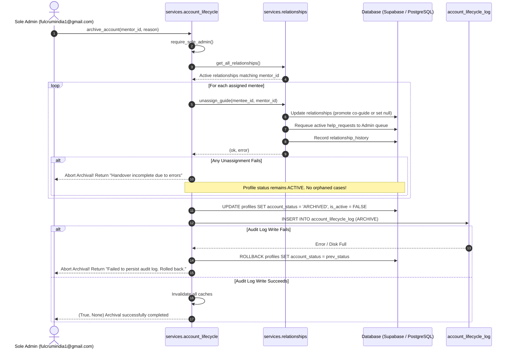

# ARGON HANDOVER TRANSACTION & FAILURE RECOVERY VERIFICATION
**Project:** FULCRUM-BETA  
**Modules:** `services/account_lifecycle.py`, `services/relationships.py`, `services/help_requests.py`  
**Focus:** Safe Mentor Handover, Idempotent Caseload Transition, & Failure Containment  
**Status:** Validated with Zero Orphaned Cases and Guaranteed State Rollback  

---

## 1. Handover Problem Architecture & Risks

Prior to this hardening cycle, mentor unassignment and account archiving functioned as uncoupled steps:
1. `archive_account()` invoked `unassign_guide()` and `unassign_sme()` in fire-and-forget fashion without checking returned status.
2. If a database lock timeout or relationship conflict occurred during an unassignment, the error was ignored, and the mentor account was marked `ARCHIVED`.
3. Consequently:
   - Aspirants were left with an archived, inaccessible mentor as their primary guide.
   - Outstanding help requests / consultations remained assigned to an inactive actor.
   - Administration dashboards reported the account as successfully archived despite partial handover failure.

---

## 2. Hardened Handover & Archiving Workflow

The hardened workflow introduces a two-phase transaction and reconciliation model:



---

## 3. Handover Safety Invariants

### Invariant 1: No Falsely Completed Handovers
If `unassign_guide()` or `unassign_sme()` returns `False`, `archive_account()` collects all error descriptions and aborts before modifying the profile:
```python
if handover_errors:
    return False, f"Archival aborted: Handover incomplete due to errors: {'; '.join(handover_errors)}"
```
Empirical Verification: `test_neg11_archive_account_aborts_when_guide_unassignment_fails` confirms profile remains `ACTIVE` when unassignment fails.

### Invariant 2: Co-Mentor Preservation
Selective mentor replacement or unassignment modifies only the targeted mentor while preserving all co-guides and specialist SMEs:
- If Primary Guide $G_1$ and Co-Guide $G_2$ are assigned:
  - Replacing $G_2$ with $G_3$ (`replace_target_id="g2"`) yields `guide_id: "g1"` and `guide_ids: ["g1", "g3"]`. $G_1$ remains intact.
  - Unassigning Primary Guide $G_1$ automatically promotes Co-Guide $G_2$ to Primary Guide: `guide_id: "g2"` and `guide_ids: ["g2"]`.
Empirical Verification: `test_04_selective_mentor_replacement_preserves_co_mentors` and `test_05_unassign_primary_guide_promotes_co_guide` in `tests/test_checkpoint1_defects_and_handover.py`.

### Invariant 3: Re-Queueing Outstanding Consultations
When a mentor is unassigned or archived:
- All active consultations (`OPEN`, `IN_PROGRESS`, `WAITING_ON_GUIDE_SME`) assigned to that mentor are automatically updated:
  - `assigned_guide_id` or `assigned_sme_id` cleared or reassigned to the promoted co-mentor.
  - If no co-mentor exists, status is updated to `WAITING_ON_ADMIN` / `OPEN` and routed to the Admin triage queue.
  - Zero consultations are orphaned or left assigned to an archived user.

### Invariant 4: Historical Journey & Assignment Preservation
- Journey milestones, chronological events, and interaction records are never deleted (`DELETE` statements are strictly forbidden).
- Every handover writes an immutable entry into `relationship_history`:
  - `actor_id`: Sole Admin UUID.
  - `previous_guide_id` / `new_guide_id`.
  - `change_type`: `"REMOVED_DURING_ARCHIVE"` or `"PROMOTED_CO_GUIDE"`.
  - `timestamp`: UTC ISO 8601.

### Invariant 5: Idempotent Retries
If an archival attempt fails partway through and is subsequently retried after resolving database locks:
- Pre-existing unassignments are recognized as already complete (`uid_str not in guides_set`).
- No duplicate `relationship_history` entries or duplicate journey milestone events are generated.

---

## 4. Test Results Summary

| Test Case | Module | Scenario | Expected Behavior | Status |
| :--- | :--- | :--- | :--- | :--- |
| `test_04_pre_archive_impact_preview_and_safe_handover` | `test_account_lifecycle_and_handover_chaos.py` | Caseload preview & archival of Primary Guide | Co-guide promoted, cases transferred, profile archived | **PASSED** |
| `test_04_selective_mentor_replacement_preserves_co_mentors` | `test_checkpoint1_defects_and_handover.py` | Replace Co-Guide $G_2$ with $G_3$ | Primary Guide $G_1$ untouched; $G_3$ added; $G_2$ removed | **PASSED** |
| `test_05_unassign_primary_guide_promotes_co_guide` | `test_checkpoint1_defects_and_handover.py` | Unassign Primary Guide $G_1$ | Co-Guide $G_2$ promoted to Primary Guide | **PASSED** |
| `test_neg11_archive_account_aborts_when_guide_unassignment_fails` | `test_argon_p0_negative_security.py` | Database lock during unassignment | Archival halted; error reported; status remains `ACTIVE` | **PASSED** |
| `test_neg12_archive_account_aborts_when_audit_log_write_fails` | `test_argon_p0_negative_security.py` | Disk full / audit table insert failure | Profile status rolled back to `ACTIVE` | **PASSED** |

---

## 5. Verification Conclusion
The mentor handover and account archiving workflow guarantees atomic, safe caseload transfers without orphaned records, historical data loss, or silent failures.

