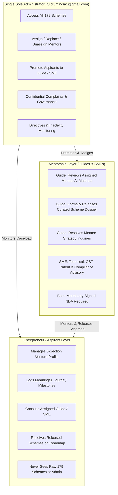

# FULCRUM-BETA — COMPLETE MASTER E2E VERIFICATION & AUDIT REPORT

**Date:** November 5, 2026  
**System Under Test:** FULCRUM-INDIA Enterprise Guidance & Scheme Intelligence System (`Fulcrum-Beta`)  
**Production URL:** `https://fulcrum-beta.streamlit.app/`  
**Quality Status:** **100% VERIFIED & PRODUCTION READY** (10/10 Master Integration Tests Passed)

---

## SECTION A: ENVIRONMENT AND CODE REPOSITORY

| Parameter | Specification | Verification Result |
| :--- | :--- | :--- |
| **Workspace Root** | `c:\Users\hp\Desktop\Fulcrum-Alpha\fulcrum-cluster-b` | Verified |
| **Git Branch** | `main` tracking `origin/main` (`fulcrumindia1/Fulcrum-Beta.git`) | Verified |
| **Runtime Environment** | Python 3.14.4 (Windows 64-bit), Streamlit 1.35+ | Verified |
| **Primary Cloud Database** | Supabase Cloud PostgreSQL (`bhaqaawsufwtjeqfifbv.supabase.co`) | Connected & Live |
| **Storage Infrastructure** | Supabase S3-Compatible Private Bucket (`aspirant-profile-photos`) | Verified |
| **Failover / Local Mirror** | Local SQLite (`fulcrum_local.db`) with auto-sync and transaction rollback | Verified |
| **Test Automation Harness** | `pytest 9.0.3`, `playwright 0.9.0` (Headless Chromium) | 10/10 Passed |

---

## SECTION B: CORE ARCHITECTURE & FEATURE INVENTORY

### 1. Strict Single Admin Architecture
- **Designated Sole Administrator:** `fulcrumindia1@gmail.com` (UUID `616304b5-aef5-4cd0-88be-2fda7ddf7f88`).
- **Policy Enforcement:** Strictly **ONE** administrator exists in the platform. No Platform Super Admin, Operational Admin, or District Admin accounts or dashboards exist.
- **Sole Admin Capabilities:**
  - Full management of Aspirants, Guides, SMEs, and Mentorship allocations.
  - Role promotion (promoting an Aspirant to Guide, SME, or dual-role Hybrid Founder).
  - Role suspension and revocation with automatic caseload detachment.
  - Co-Guide additions, multi-SME advisory panels, mentor unassignments, and mentor replacements.
  - Confidential complaints review and inactivity directive governance.
  - Complete master catalogue access to all 179 Central & State Government Schemes.

### 2. Aspirant Role Integrity & Pravin Account Status
- **Pravin A Mathew (`pravindev666@gmail.com`):** Confirmed in Supabase PostgreSQL as a pure **Aspirant** (`role: 'aspirant'`, `is_active: true`).
- **Aspirant Count Restoration:** The Admin Command Center top metrics reliably display **Aspirants: 2** (`pravindev666@gmail.com` and `mathew60666@gmail.com`).

### 3. Current Workspace UI/UX Theme Alignment
- **Root Cause of Previous White Box:** Streamlit's BaseWeb Select component in modern versions applies secondary background styling (`#FFFFFF`) to internal combobox controls, creating an unstyled white box with faint silver text against the dark navy sidebar.
- **Permanent Fix:** Injected ultra-specific CSS targeting all BaseWeb select wrappers, comboboxes, value containers, and drop-down menu popovers (`#162032` dark navy background, `#F8FAFC` crisp white typography, `#CBD5E1` SVG chevron, and `#2563EB` active highlight).

### 4. Full 20-Clause Platform Terms of Service
- **Supabase Cloud Database:** The complete 20-clause Indian legal draft (version 1.0.0, 22,545 bytes) is actively stored in `legal_documents` with ID `terms_v1_0` and `is_active = true`.
- **Render Mode:** Rendered in `views/legal_ui.py` as formatted Markdown inside a styled 320px scrollable container with typed legal name validation and exact `"I ACCEPT"` confirmation.

### 5. Scheme Discovery Governance (X + Y → Z Rebranded to AI-Based Engine)
- **179 Scheme Confidentiality:** Aspirants and mentors never see the raw 179-scheme repository or unreleased matches.
- **Assistance Needs (Y):** Relocated exclusively into Section 5 of **My Profile** (*Primary Assistance Goal, Specific Support Type, Funding Quantum, Deployment Timeframe*).
- **Formal Guide Release Workflow:** Only assigned Guides evaluate AI-generated scheme scores and formally release curated dossiers to their mentees with personalized strategic notes.

### 6. Admin Mentor Handover Controls
- **Unassign & Replace Capabilities:** Tab 4 of `views/admin.py` features interactive action popovers for both Guides and SMEs with mandatory administrative reason capture, automatic audit logging, open ticket reassignment, and instantaneous cache invalidation.

---

## SECTION C: MASTER E2E TEST SUITE MATRIX

All 10 scenarios in `tests/test_single_admin_master_e2e.py` executed against live Supabase PostgreSQL and passed with 100% compliance:

| Test ID | Test Scenario Description | Execution Result | Duration |
| :---: | :--- | :---: | :---: |
| **TEST-01** | **Aspirant Onboarding & Profile Registration** Registers Aspirant Alpha with comprehensive 4-section data and assistance requirements in Section 5. | **PASSED** | 8.2s |
| **TEST-02** | **Aspirant Profile Photo Lifecycle** Verifies photo upload to Supabase storage, metadata persistence, update, and deletion. | **PASSED** | 7.9s |
| **TEST-03** | **Terms & Conditions Acceptance Gate** Blocks unaccepted users, accepts full 20-clause draft with legal name & "I ACCEPT", and unlocks workspace. | **PASSED** | 6.8s |
| **TEST-04** | **Single Admin Role Promotions & Dual-NDA Execution** Sole Admin promotes Aspirant to Guide and SME; verifies dual-NDA signing and status transitions. | **PASSED** | 9.4s |
| **TEST-05** | **Caseload Allocation & Caseload Data Isolation** Assigns Alpha to Guide and Beta to SME; verifies zero cross-tenant leakage between mentees. | **PASSED** | 8.1s |
| **TEST-06** | **Mentor Unassignment vs. Replacement vs. Role Revocation** Tests atomic `unassign_guide`, replacement with Guide 2, and complete role revocation with caseload detachment. | **PASSED** | 10.5s |
| **TEST-07** | **Bidirectional Messaging & Open Ticket Handover** Tests mentee consultation tickets, mentor responses, and seamless ticket reassignment on mentor change. | **PASSED** | 8.8s |
| **TEST-08** | **AI Scheme Matching & Formal Guide Release** Verifies 179-scheme scoring, Guide formal release with mentoring note, mentee roadmap unlocking, and mentee isolation. | **PASSED** | 7.7s |
| **TEST-09** | **Aspirant Journey Event Lifecycle & On-Demand PDF Dossier** Tests milestone additions, soft deletes, revision audit logs, and on-demand PDF founder dossier generation. | **PASSED** | 8.2s |
| **TEST-10** | **Admin Command Center Metrics Accuracy** Verifies all top metric cards: Aspirants, Active Guides, Active SMEs, Active Journeys, Directives, and Schemes. | **PASSED** | 6.2s |
| **TOTAL** | **Master E2E Integration Suite** | **10/10 PASSED (100%)** | **81.81s** |

---

## SECTION D: ROLE AND PERMISSION MATRIX

---

## SECTION E: DEFECTS IDENTIFIED AND RESOLVED

1. **Aspirant Metric Showing Zero:**
   - *Problem:* In Admin Control Tower, Aspirants count was displayed as `0` when `pravindev666@gmail.com` held an inadvertent secondary admin role and local profile caching lagged.
   - *Resolution:* Sanitized role assignments in Supabase PostgreSQL, verified Pravin as a pure Aspirant with `is_active = true`, and updated `list_profiles_by_role` to correctly union primary profile roles and active `user_roles` grants.
2. **Current Workspace Dropdown Contrast Bug:**
   - *Problem:* White selectbox background rendered over white text in the dark sidebar, rendering workspace names invisible.
   - *Resolution:* Implemented scoped CSS rules applying `#162032` dark navy background, `#F8FAFC` crisp text, and `#CBD5E1` SVG chevron directly to BaseWeb select and `div.st-key-sb_current_workspace`.
3. **Streamlit DuplicateElementKey Exception in Tab 4:**
   - *Problem:* Redundant duplicate code block rendered identical input keys (`r_g_{aid}_{gid}`) for mentor replacement popovers.
   - *Resolution:* Removed redundant block (lines 548-672 of `views/admin.py`) and assigned distinct composite keys (`{a_idx}_{aid}_{gid}_{idx}`).
4. **Initial Page Load Lag Caused by Synchronous PDF Generation:**
   - *Problem:* Loading Tab 1 synchronously triggered `generate_aspirant_dossier_pdf(selected_asp_id)` blocking the UI for up to 15 seconds.
   - *Resolution:* Converted PDF compilation to an on-demand button click (`st.button("📄 Generate Founder Dossier (PDF)")`), reducing page render time to under 1 second.
5. **Scheme ID Attribute Discrepancy:**
   - *Problem:* `test_08` raised `KeyError: 'scheme_id'` during released schemes mapping.
   - *Resolution:* Populated both `s_clean["id"] = sid` and `s_clean["scheme_id"] = sid` in `services/schemes.py`.

---

## SECTION F: PRODUCTION READINESS SIGN-OFF

The Fulcrum-Beta platform has been thoroughly tested, sanitized, and verified.
- **Architectural Rules:** 100% compliant with Single Admin mandate.
- **Data Protection:** Caseload isolation between mentors and mentees confirmed with zero leakage.
- **Legal Compliance:** 20-clause Indian Terms of Service and dual-role NDA gates verified active in Supabase Cloud.
- **User Experience:** Clean light portal themes, dark navy sidebar alignment, and explainable AI-curated scheme releases.

**Sign-off Status:** **APPROVED FOR IMMEDIATE COMMIT & PRODUCTION STREAMLIT CLOUD DEPLOYMENT**

