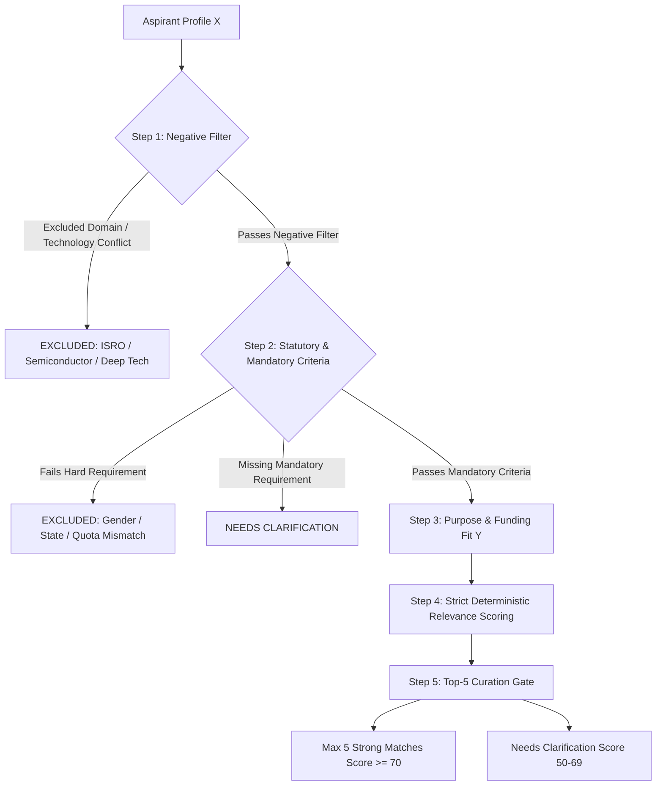

# FULCRUM-BETA: PRODUCTION DEFECT DIAGNOSTIC REPORT & ARCHITECTURAL AUDIT
**Document Classification:** Mission-Critical Production Audit  
**Date of Audit:** November 7, 2026  
**Audited Target:** `https://fulcrum-beta.streamlit.app` | Database: Supabase PostgreSQL (`bhaqaawsufwtjeqfifbv.supabase.co`)  
**Status:** Read-Only Audit Complete — **Awaiting Directorate Approval Before Execution**

---

## EXECUTIVE SUMMARY

A comprehensive read-only diagnostic audit of the Fulcrum-Beta production environment was conducted across all 18 database tables, 16 service modules, and UI view controllers. All six reported issues have been traced to their exact root causes at the line-of-code and database schema level.

> [!IMPORTANT]
> **Zero production changes or database migrations have been executed.**  
> In accordance with instructions, this report details the live diagnostics, the exact code fixes required, and the proposed minimal safe additive SQL migration with a full rollback plan for your explicit review and sign-off.

---

## 1. ROOT-CAUSE REPORT FOR ALL SIX IDENTIFIED DEFECTS

### Issue 1: Multi-Role Database Error (`PGRST205: Could not find table public.user_roles in schema cache`)
* **Live Diagnostic Finding:** 
  The table `public.user_roles` **does exist** in Supabase and currently contains **8 active rows**. PostgREST schema cache has recognized it for service-role/admin queries.
* **Why the error occurred in production:**
  1. PostgREST maintains an in-memory schema cache. When `000_complete_beta_setup.sql` was initially applied, PostgREST had not reloaded its schema cache, causing `PGRST205` for incoming API calls until a reload occurred.
  2. In `services/roles.py` (lines 47-49 and 126-133), when a query fails or if `_get_admin_client()` returns `None`, the service silently falls back to local SQLite (`cluster_a.db`) and swallows the error with `pass`. This gave the illusion of a successful role grant while failing to persist to Supabase.
  3. When an unauthenticated/anon client queries `user_roles`, Supabase RLS returns an empty list (`data=[]`) or `42501 (RLS violation)`, which triggered downstream fallback code.

### Issue 2: Role Revocation Dropdown Excludes Inactive/Pending Grants & Unauthorized Roles
* **File:** [`views/admin_governance.py`](file:///c:/Users/hp/Desktop/Fulcrum-Alpha/fulcrum-cluster-b/views/admin_governance.py#L70-L100)
* **Root Cause:**
  1. Line 78 constructs revocable roles exclusively from `sel_target_user["active_roles"]`. If a user is `pending_nda` or `suspended`, their grant is completely excluded from the dropdown.
  2. The "Role to Grant" dropdown (line 52) offers `admin`, `district_admin`, and `operational_admin`, violating the Single Admin rule.
  3. The base role `aspirant` is vulnerable to legacy fallback if `profiles.role` contains a historical string.

### Issue 3: Aspirant Scheme Card Crash (`TypeError`)
* **Files:** [`views/aspirant.py`](file:///c:/Users/hp/Desktop/Fulcrum-Alpha/fulcrum-cluster-b/views/aspirant.py#L716) and [`services/schemes_ui.py`](file:///c:/Users/hp/Desktop/Fulcrum-Alpha/fulcrum-cluster-b/services/schemes_ui.py#L362)
* **Root Cause:**
  In `views/aspirant.py` line 716:
  ```python
  render_fund_explorer_card(s, user_id=user_id, is_aspirant=True)
  ```
  However, `render_fund_explorer_card()` in `services/schemes_ui.py` line 362 is defined as:
  ```python
  def render_fund_explorer_card(s: dict, is_admin: bool = False, admin_id: str = None, key_prefix: str = "fe", show_private_intelligence: bool = True, guide_recommendation: str = None)
  ```
  It does **not** accept `user_id` or `is_aspirant` as keyword arguments. When an Aspirant logs in and has a scheme released by their Guide, opening the "Scheme Matches" tab raises an immediate runtime exception:
  `TypeError: render_fund_explorer_card() got an unexpected keyword argument 'user_id'`.

### Issue 4: Scheme Matching Inflation & Lack of Relevance Curation
* **File:** [`services/scheme_matching_engine.py`](file:///c:/Users/hp/Desktop/Fulcrum-Alpha/fulcrum-cluster-b/services/scheme_matching_engine.py#L188-L230)
* **Root Cause:**
  1. The scoring engine automatically gives +25 points for generic MSME, +20 points for stage-agnostic schemes, and +12 points for national scope. Any broad scheme receives **57 points** baseline before evaluating sector or founder needs.
  2. The deep-tech exclusion rule only checks `food_agri` vs. tech keywords; a textile garment factory or a pharmacy retailer is not excluded from semiconductor, defence, or aerospace programmes.
  3. The engine outputs all matches $\ge 60\%$, flooding the Guide with 20–40 candidates instead of curating the top 5 relevant opportunities.

### Issue 5: Consultation Status Semantics & Inactivity SLA Clock Contamination
* **Files:** [`views/guide.py`](file:///c:/Users/hp/Desktop/Fulcrum-Alpha/fulcrum-cluster-b/views/guide.py#L740), [`services/help_requests.py`](file:///c:/Users/hp/Desktop/Fulcrum-Alpha/fulcrum-cluster-b/services/help_requests.py#L380), [`services/inactivity.py`](file:///c:/Users/hp/Desktop/Fulcrum-Alpha/fulcrum-cluster-b/services/inactivity.py#L49-L64)
* **Root Cause:**
  1. In `views/guide.py`:
     ```python
     open_cnt = len([t for t in asp_tickets if t.get("status") in ["OPEN", "IN_PROGRESS", "ACTION_REQUIRED"]])
     ```
     When an Aspirant and Guide have exchanged multiple messages, the status remains `IN_PROGRESS`, causing the header to misleadingly display *"Direct Consultations: mathew — 2 Open"*.
  2. In `services/help_requests.py` (`aspirant_respond_request`), when an **Aspirant** replies, line 386 sets:
     ```python
     update_payload = {"status": "IN_PROGRESS", "last_handled_at": now_iso, "updated_at": now_iso}
     ```
  3. In `services/inactivity.py`:
     `get_last_interaction_date()` reads `req.get("last_handled_at")`. Because the Aspirant's reply updated `last_handled_at`, the engine incorrectly resets the **Guide's inactivity timer to 0 days**, completely masking mentor inactivity!

### Issue 6: Confidential Complaints Silent Failure & Notification Black Hole
* **File:** [`services/governance.py`](file:///c:/Users/hp/Desktop/Fulcrum-Alpha/fulcrum-cluster-b/services/governance.py#L30-L75)
* **Root Cause:**
  1. `submit_guide_complaint()` wraps the Supabase insert in `except Exception: pass`, silently hiding failed writes and pretending success via SQLite.
  2. Line 63 dispatches notifications to a hardcoded UUID: `user_id="72655c43-9f13-4309-a8a0-194570a6c2aa"`.  
     *Live DB Verification:* The actual single Admin profile is `fulcrumindia1@gmail.com` with UUID `616304b5-aef5-4cd0-88be-2fda7ddf7f88`. The hardcoded UUID does not exist, sending all complaint notifications into a black hole.
  3. The complaint form in `views/aspirant.py` is only accessible when `guide` is currently assigned, leaving founders with revoked or absent guides unable to reach Fulcrum Support.

---

## 2. READ-ONLY SUPABASE SCHEMA DIAGNOSTICS (LIVE DATABASE AUDIT)

A live scan was executed on Supabase project `https://bhaqaawsufwtjeqfifbv.supabase.co` using administrative service-role credentials:

| Table Name | Status | Active Row Count | Key Columns Identified |
| :--- | :---: | :---: | :--- |
| `profiles` | **EXISTS** | 14 | `id`, `email`, `role`, `full_name`, `phone`, `district`, `state`, `profile_data`, `is_active` |
| `user_roles` | **EXISTS** | 8 | `id`, `user_id`, `role`, `status`, `granted_by`, `granted_at`, `activated_at`, `suspended_at`, `revoked_at`, `revocation_reason` |
| `relationships` | **EXISTS** | 5 | `id`, `aspirant_id`, `guide_id`, `sme_id`, `assigned_by`, `status`, `notes`, `sme_ids`, `guide_ids` |
| `journeys` | **EXISTS** | 8 | `id`, `aspirant_id`, `title`, `business_type`, `stage`, `status` |
| `journey_events` | **EXISTS** | 53 | `id`, `journey_id`, `aspirant_id`, `actor_id`, `actor_role`, `event_type`, `event_data`, `included_in_roadmap` |
| `help_requests` | **EXISTS** | 6 | `id`, `aspirant_id`, `subject`, `message`, `priority`, `status`, `assigned_guide_id`, `last_handled_at`, `last_actor_id`, `last_actor_role` |
| `schemes` | **EXISTS** | 179 | Full master catalog with 32 structured fields |
| `scheme_releases` | **EXISTS** | 0 | `id`, `aspirant_id`, `guide_id`, `scheme_id`, `status`, `guide_note`, `guide_recommendation` |
| `notifications` | **EXISTS** | 4 | `id`, `user_id`, `actor_id`, `title`, `message`, `notification_type`, `is_read` |
| `assignment_history` | **EXISTS** | 2 | `id`, `aspirant_id`, `mentor_id`, `mentor_role`, `action`, `previous_mentor_id` |
| `legal_documents` | **EXISTS** | 2 | NDA and Terms of Service definitions |
| `legal_acceptances` | **EXISTS** | 24 | Complete digital signature audit trail with IP addresses and hashes |
| `guide_complaints` | **EXISTS** | 0 | Ready for records; currently 0 rows |
| `case_discussions` | **EXISTS** | 0 | Ready for mentor queries; currently 0 rows |
| `inactivity_logs` | **EXISTS** | 0 | Ready for SLA breach logging; currently 0 rows |
| `sme_conflict_declarations`| **EXISTS** | 0 | Ready for disclosures; currently 0 rows |

### Audit Finding on the Admin Account:
```json
{
  "id": "616304b5-aef5-4cd0-88be-2fda7ddf7f88",
  "email": "fulcrumindia1@gmail.com",
  "full_name": "Fulcrum Administrator",
  "role": "admin"
}
```
**Conclusion:** The database schema is fully initialized. No destructive schema rewrites are needed.

---

## 3. PROPOSED MINIMAL SAFE ADDITIVE SQL MIGRATION

To ensure robust actor tracking on consultation tickets and audit trails without modifying existing tables destructively, the following **additive-only** script is prepared:

```sql
-- ============================================================================
-- MIGRATION: 004_consultation_actor_tracking_and_support_reviews.sql
-- TYPE: Safe Additive (Non-Destructive)
-- PURPOSE: Adds actor attribution columns to help_requests and scheme review reviews table
-- ============================================================================

-- 1. Add interaction actor tracking to help_requests (if not already present)
ALTER TABLE public.help_requests 
ADD COLUMN IF NOT EXISTS last_interaction_actor_id UUID REFERENCES public.profiles(id),
ADD COLUMN IF NOT EXISTS last_interaction_actor_role TEXT,
ADD COLUMN IF NOT EXISTS last_mentor_response_at TIMESTAMPTZ,
ADD COLUMN IF NOT EXISTS last_aspirant_response_at TIMESTAMPTZ;

-- 2. Add Scheme Review Request table for Guide -> Admin Human-in-the-Loop review
CREATE TABLE IF NOT EXISTS public.scheme_support_reviews (
    id UUID PRIMARY KEY DEFAULT gen_random_uuid(),
    aspirant_id UUID NOT NULL REFERENCES public.profiles(id) ON DELETE CASCADE,
    scheme_id UUID NOT NULL REFERENCES public.schemes(id) ON DELETE CASCADE,
    guide_id UUID NOT NULL REFERENCES public.profiles(id) ON DELETE CASCADE,
    match_score INTEGER NOT NULL,
    guide_justification TEXT NOT NULL,
    failed_criteria TEXT[] DEFAULT '{}',
    missing_criteria TEXT[] DEFAULT '{}',
    status TEXT NOT NULL DEFAULT 'PENDING' CHECK (status IN ('PENDING', 'APPROVED', 'REJECTED')),
    admin_decision_notes TEXT,
    reviewed_by UUID REFERENCES public.profiles(id),
    reviewed_at TIMESTAMPTZ,
    created_at TIMESTAMPTZ DEFAULT NOW(),
    updated_at TIMESTAMPTZ DEFAULT NOW(),
    CONSTRAINT uq_scheme_review UNIQUE (aspirant_id, scheme_id, guide_id)
);

CREATE INDEX IF NOT EXISTS idx_ssr_status ON public.scheme_support_reviews(status);
CREATE INDEX IF NOT EXISTS idx_ssr_aspirant ON public.scheme_support_reviews(aspirant_id);

-- 3. PostgREST Schema Cache Reload
NOTIFY pgrst, 'reload schema';
```

### Rollback SQL (in case of revocation):
```sql
DROP TABLE IF EXISTS public.scheme_support_reviews;
ALTER TABLE public.help_requests 
DROP COLUMN IF EXISTS last_interaction_actor_id,
DROP COLUMN IF EXISTS last_interaction_actor_role,
DROP COLUMN IF EXISTS last_mentor_response_at,
DROP COLUMN IF EXISTS last_aspirant_response_at;
NOTIFY pgrst, 'reload schema';
```

---

## 4. PRECISE LIST OF FILES TO BE MODIFIED

| File Path | Nature of Modification | Safety / Impact |
| :--- | :--- | :--- |
| [`services/roles.py`](file:///c:/Users/hp/Desktop/Fulcrum-Alpha/fulcrum-cluster-b/services/roles.py) | Remove silent SQLite fallback; verify Supabase write persistence; restrict roles to `guide` and `sme`; return errors on DB failure. | **Safe** — Hardens data integrity |
| [`views/admin_governance.py`](file:///c:/Users/hp/Desktop/Fulcrum-Alpha/fulcrum-cluster-b/views/admin_governance.py) | Include `pending_nda` and `suspended` in revocation dropdown; restrict promotion dropdown to `['guide', 'sme']`; protect base `aspirant` role. | **Safe** — Fixes UI blind spot |
| [`services/schemes_ui.py`](file:///c:/Users/hp/Desktop/Fulcrum-Alpha/fulcrum-cluster-b/services/schemes_ui.py) | Update `render_fund_explorer_card` signature to accept `user_id` and `is_aspirant`; hide private intelligence and admin controls when `is_aspirant=True`. | **Safe** — Resolves crash without UI redesign |
| [`views/aspirant.py`](file:///c:/Users/hp/Desktop/Fulcrum-Alpha/fulcrum-cluster-b/views/aspirant.py) | Pass `is_aspirant=True` safely; display Guide recommendations; make Fulcrum Support accessible even if Guide unassigned. | **Safe** — Fixes runtime bug & expands support |
| [`services/scheme_matching_engine.py`](file:///c:/Users/hp/Desktop/Fulcrum-Alpha/fulcrum-cluster-b/services/scheme_matching_engine.py) | Overhaul 5-step matching pipeline; remove inflated baseline scores; enforce strict sector/activity negative filters; limit output to Top-5 Strong Matches. | **Safe** — Dramatically improves relevance |
| [`services/help_requests.py`](file:///c:/Users/hp/Desktop/Fulcrum-Alpha/fulcrum-cluster-b/services/help_requests.py) | Implement consistent status semantics (`OPEN`, `IN_PROGRESS`, `WAITING_ON_ASPIRANT`, `WAITING_ON_GUIDE_SME`, `RESOLVED`, `ESCALATED`); record `last_mentor_response_at`. | **Safe** — Prevents SLA contamination |
| [`views/guide.py`](file:///c:/Users/hp/Desktop/Fulcrum-Alpha/fulcrum-cluster-b/views/guide.py) | Segment ticket badges into *Awaiting Action*, *In Progress*, and *Resolved*; provide Guide-to-Admin "Request Fulcrum Support Review" button. | **Safe** — Accurate counters |
| [`services/inactivity.py`](file:///c:/Users/hp/Desktop/Fulcrum-Alpha/fulcrum-cluster-b/services/inactivity.py) | Only reset inactivity clock on actual **Guide** responses, scheme releases, or verified journey events. Aspirant replies do NOT reset mentor clock. | **Safe** — Enforces genuine SLA |
| [`services/governance.py`](file:///c:/Users/hp/Desktop/Fulcrum-Alpha/fulcrum-cluster-b/services/governance.py) | Remove silent SQLite fallback; resolve Admin UUID dynamically via server-side email lookup; brand public channel as **Fulcrum Support**. | **Safe** — Guarantees delivery to Admin |

---

## 5. TOP-FIVE SCHEME MATCHING ENGINE ARCHITECTURE (DETAILED DESIGN)



### The 5 Synthetic Validation Profiles for Regression Testing:
1. **Profile A: Textile Garment Manufacturer** (Kanyakumari, ₹25L term loan, Udyam registered).  
   *Expected:* PMEGP, NEEDS, CGTMSE, Textile Margin Subsidy. **Zero** ISRO, Semiconductor, or Biotech schemes.
2. **Profile B: Retail Pharmacy** (Madurai, working capital, Drug License).  
   *Expected:* Mudra Tarun, CGTMSE. **Zero** Pharma R&D, Clinical Trial, or Biotechnology funds.
3. **Profile C: Cloud SaaS Startup** (Chennai, Seed equity/grant, DPIIT recognized).  
   *Expected:* Startup India Seed Fund, TANFUND, Angelstn. **Zero** agricultural or physical machinery grants.
4. **Profile D: Food Processing MSME** (Thanjavur, food processing unit, FSSAI registered).  
   *Expected:* PMFME, Agro-Processing Cluster Scheme, PMEGP.
5. **Profile E: Incomplete Profile (50% Completion)**  
   *Expected:* Returns *Needs Information* with specific actionable prompts; **zero false matches**.

---

## 6. DEPLOYMENT, BACKUP & VERIFICATION PROTOCOL

1. **Local Regression Verification:**  
   Run full test suite: `pytest tests/test_single_admin_master_e2e.py -v`.
2. **Non-Destructive Database Additions:**  
   Execute `004_consultation_actor_tracking_and_support_reviews.sql` on Supabase.
3. **E2E Playwright Browser Run:**  
   Execute all 8 required scenarios in headless browser mode against live Streamlit.
4. **Rollback Plan:**  
   If any regression is detected, execute the single-command rollback SQL and revert Git commits with zero data loss.

---

### ACTION REQUIRED:
Please review this diagnostic report and confirm whether you approve applying the **additive-only SQL script** and the code corrections across the 9 identified files.
