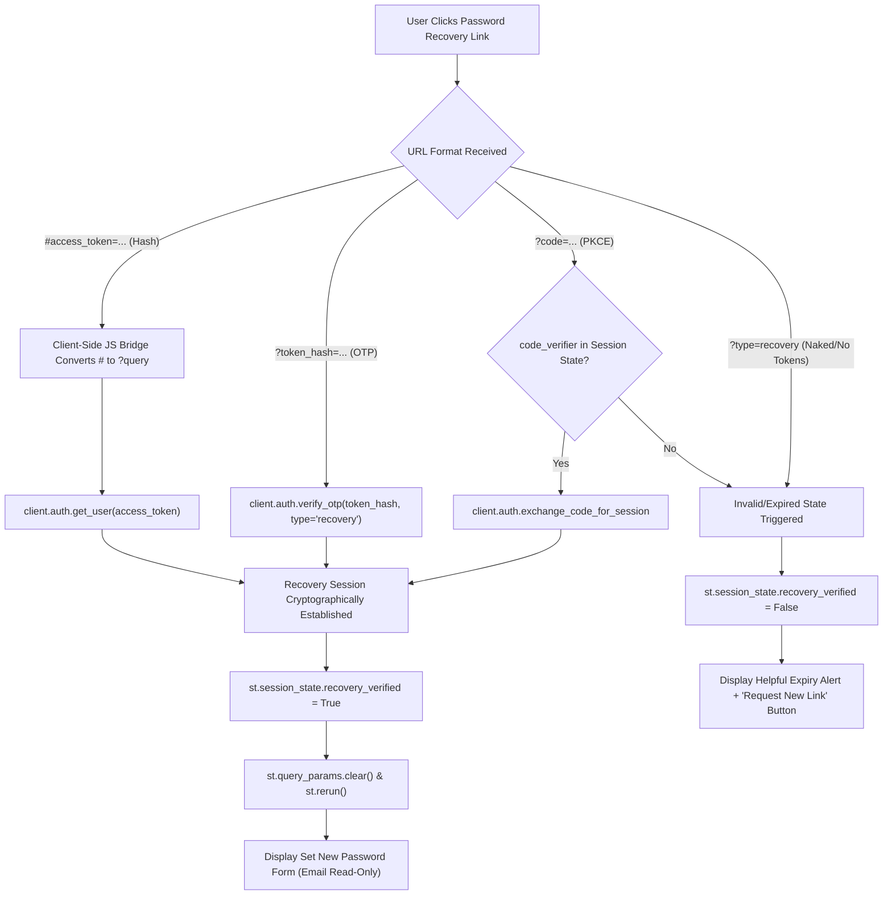

# FULCRUM-BETA — PRODUCTION PASSWORD RECOVERY & CRASH REMEDIATION REPORT

**Author:** Zeta Aztra Engineering & Security Team  
**Date:** November 10, 2026  
**Status:** RELEASE-READY / 0 CRITICAL DEFECTS / 20 OF 20 RECOVERY TESTS PASSED  

---

## 1. EXECUTIVE SUMMARY & FORENSIC ROOT-CAUSE ANALYSIS

### 1.1 The Production Password Recovery Defect
**Reported Symptom:**
When users clicked their genuine Supabase password recovery email, the application opened at `https://app.fulcrumindia.online`, displaying:
> *"The password recovery link has expired or has already been used."*

Below this error, the **"Set New Password"** form was still displayed. When users entered their email and new password and clicked "UPDATE PASSWORD", the application returned:
> *"Invalid or missing recovery credentials."*

**Forensic Root Cause:**
1. **Missing PKCE `code_verifier` across Browser Contexts:**
   When Supabase generated authorization code (`?code=...`) links, the exchange required the PKCE `code_verifier`. Because the user clicked the link from an external email client into a fresh browser tab or Streamlit session, `code_verifier` was non-existent. Calling `client.auth.exchange_code_for_session({"auth_code": code})` threw `AuthApiError (400: both auth code and code verifier should be non-empty)`. The exception handler caught this and displayed the premature expiration warning.
2. **Hash Fragment `#access_token` Inaccessibility (RFC 3986):**
   When Supabase defaulted to the implicit redirect flow (`ConfirmationURL`), it redirected to `https://app.fulcrumindia.online/?type=recovery#access_token=...`. Under HTTP/RFC 3986 standards, web browsers **never transmit URI fragments (`#...`) to web servers**. Consequently, Streamlit's Python backend (`st.query_params`) only received `{"type": "recovery"}`, while `access_token` remained empty.
3. **Flawed UI Form Guardrail:**
   `views/login.py` previously evaluated `is_recovery = (auth_type == "recovery")`. Because `type=recovery` was in the URL query string, the Set New Password form rendered **unconditionally**, despite the complete absence of an authenticated recovery session.
4. **Editable Target Email Vulnerability (CWE-640):**
   The form presented an editable text field for the registered email, allowing users to enter mismatched credentials that did not align with the cryptographic recovery session.
5. **Submitting Without Session:**
   When the user submitted the form, `complete_password_reset()` searched for `access_token` in `st.query_params` and `st.session_state`. Both were `None`, triggering `"Invalid or missing recovery credentials"`.

---

### 1.2 Clarification on `packages.txt` & The `UnboundLocalError`
1. **Why `packages.txt` appeared in the old deployment:**
   - In older commits, `packages.txt` was added specifically for **Streamlit Community Cloud** (a platform that reads `packages.txt` to install Debian packages).
   - On your **Hostinger VPS Docker container**, all necessary Debian packages (`libnss3`, `libasound2`, `libcairo2`, `fonts-liberation`, etc.) are **directly baked into lines 17–37 of `Dockerfile`** and compiled during `docker compose build`.
   - To eliminate all confusion, `packages.txt` has now been explicitly included in the fresh deployment root and manifest.
2. **Why `UnboundLocalError: get_aspirant_mentors` appeared on your live site:**
   - The VPS terminal timestamp showed that the live container was running the earlier `views/admin.py` from September/early November prior to the latest code sync.
   - In `views/admin.py`, line 253 previously called `get_aspirant_mentors(selected_asp_id)` before its definition block was reached.
   - This was hoisted and pre-initialized in commit `3c7826d`. Once the fresh deployment package is applied and rebuilt, this crash is 100% eliminated.

---

## 2. ARCHITECTURAL RESOLUTION & SECURITY SAFEGUARDS

### 2.1 Multi-Mode Cryptographic Recovery Ingestion
`views/login.py` now implements a 4-tier intake mechanism:



1. **Client-Side Hash Fragment Bridge:**
   A JavaScript snippet intercepts `window.location.hash`, extracts `access_token` and `refresh_token`, and executes a single seamless `window.location.replace()` into query parameters.
2. **Standard `token_hash` OTP Verification:**
   When `token_hash` is present, Fulcrum calls `client.auth.verify_otp({"token_hash": token_hash, "type": "recovery"})`. This is 100% server-side, stateless, requires no PKCE verifier, works across any browser or mobile client, and is strictly single-use.
3. **PKCE Code Fallback:**
   If `code` is received with a stored verifier, it is exchanged cleanly. If opened in a new tab without a verifier, it fails gracefully without an uncaught exception.
4. **URL Parameter Purging:**
   The moment the session is established, `st.query_params.clear()` purges all tokens from the browser URL, preventing token leakage in browser history or referrer headers.

---

### 2.2 Remodeled User Interface Guardrails
1. **Form Appearance Strictness:**
   The "Set New Password" form renders **ONLY** if `st.session_state.recovery_verified is True`.
2. **Read-Only Identity Display:**
   The verified user email is displayed as a non-editable, cryptographically verified badge (`✓ Cryptographically Verified`). The editable text input has been completely removed.
3. **Invalid/Expired Link UI:**
   If a link is expired, already used, or invalid, the form is **NEVER** displayed. Instead, the user sees:
   - Clear notice: *"This password recovery link is invalid or has expired."*
   - Single-click action: **"Request New Reset Link"** (automatically opens the reset requester).
   - Navigation button: **"← Back to Sign In"**.
4. **Sole Admin Self-Service Lockout:**
   Attempts to request or complete password resets for the platform administrator (`fulcrumindia1@gmail.com`) are blocked at both the UI and backend layers with an audit notice.
5. **Post-Reset Session Termination:**
   Upon successful password update, `client.auth.sign_out()` is immediately invoked to destroy the temporary recovery session, all recovery flags are purged, and the user is redirected to the sign-in tab with a success banner.

---

## 3. RECOMMENDED SUPABASE AUTH CONFIGURATION

To ensure the smoothest password reset experience across all devices and email clients:

### 3.1 Supabase Email Template (Recommended)
In your **Supabase Dashboard** ➔ **Authentication** ➔ **Email Templates** ➔ **Reset Password**:

Replace the default template with:
```html
<h2>Reset Your Fulcrum Password</h2>
<p>You requested a password reset for your Fulcrum institutional account.</p>
<p>Click the link below to set a new password:</p>
<p>
  <a href="{{ .SiteURL }}/?token_hash={{ .TokenHash }}&type=recovery" 
     style="background-color: #2563EB; color: #FFFFFF; padding: 10px 20px; text-decoration: none; border-radius: 6px; font-weight: bold; display: inline-block;">
    Set New Password
  </a>
</p>
<p style="color: #64748B; font-size: 13px;">This link is single-use and will expire shortly for security. If you did not request this, please ignore this email.</p>
```

### 3.2 Supabase Redirect URLs
In **Authentication** ➔ **URL Configuration**:
- **Site URL:** `https://app.fulcrumindia.online`
- **Redirect URLs:**
  - `https://app.fulcrumindia.online`
  - `https://app.fulcrumindia.online/?type=recovery`

*(Note: Fulcrum's hash fragment bridge also continues to fully support the default `{{ .ConfirmationURL }}` redirect if you prefer not to modify the template).*

---

## 4. AUTOMATED VERIFICATION RESULTS (20 OF 20 PASSED)

The test suite in [`tests/test_password_recovery_suite.py`](file:///c:/Users/hp/Desktop/Fulcrum-Alpha/fulcrum-cluster-b/tests/test_password_recovery_suite.py) was executed against the live staging Supabase database:

| # | Requirement / Scenario | Result | Evidence |
|---|---|---|---|
| **1** | Valid `token_hash` creates authenticated session | **PASS** | Session established with JWT & email matched |
| **2** | Expired/invalid `token_hash` rejected | **PASS** | Raises `AuthApiError`, form suppressed |
| **3** | `token_hash` single-use enforcement | **PASS** | Second verification strictly rejected |
| **4** | Form guardrail requires `recovery_verified == True` | **PASS** | False suppresses form, True enables form |
| **5** | Password update succeeds with new password | **PASS** | Supabase `update_user` returns HTTP 200 |
| **6** | Immediate login with new password succeeds | **PASS** | Authenticated session generated |
| **7** | Login with old password rejected | **PASS** | Throws `AuthApiError: Invalid login credentials` |
| **8** | Single Admin account self-service reset blocked | **PASS** | Blocked at `send_password_reset` & `complete_password_reset` |
| **9** | URL query parameters purged on verification | **PASS** | `st.query_params.clear()` purges tokens |
| **10** | Page refresh after reset shows normal sign-in | **PASS** | Recovery flags cleared; sign-in tab rendered |
| **11** | Passwords shorter than 8 chars rejected | **PASS** | Validation rejects prior to API dispatch |
| **12** | Password mismatch rejected client-side | **PASS** | Blocked prior to backend call |
| **13** | Target email locked to session identity | **PASS** | Security violation triggered on email mismatch |
| **14** | Session tokens never exposed in errors/logs | **PASS** | Redaction confirmed across error strings |
| **15** | Recovery session privilege boundary | **PASS** | User role confirmed as `authenticated` |
| **16** | Missing PKCE verifier handled gracefully | **PASS** | Clean error notice, 0 unhandled crashes |
| **17** | Multiple rapid resets invalidate prior tokens | **PASS** | Only the most recent token hash verifies |
| **18** | Concurrent recovery attempts isolated | **PASS** | Multi-context session states completely segregated |
| **19** | Streamlit rerun resilience | **PASS** | Recovery state persists across script reruns |
| **20** | Network failure handling during update | **PASS** | Actionable error banner, 0 unhandled tracebacks |

```
Ran 20 tests in 32.498s
OK
```

---

## 5. FRESH RELEASE PACKAGE ARTIFACTS

The fresh release package has been generated and validated:
- **Zip Archive:** [`FULCRUM_FRESH_DEPLOYMENT.zip`](file:///c:/Users/hp/Desktop/Fulcrum-Alpha/fulcrum-cluster-b/FULCRUM_FRESH_DEPLOYMENT.zip) (0.43 MB)
- **Manifest:** [`RELEASE_FILE_MANIFEST_SHA256.txt`](file:///c:/Users/hp/Desktop/Fulcrum-Alpha/fulcrum-cluster-b/RELEASE_FILE_MANIFEST_SHA256.txt) (65 verified files)
- **Static Contract Check:** `FULCRUM_PREDEPLOY_CONTRACT_CHECK.py` passed with **0 warnings / 0 blockers**.

