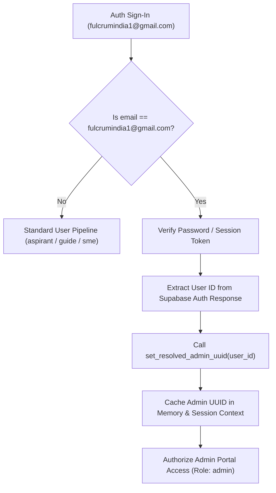

# FULCRUM-BETA 2.1 — SINGLE ADMIN AUTHORIZATION MATRIX & SECURITY ARCHITECTURE

**Document Status:** Institutional Security Specification  
**Date:** November 10, 2026  
**Auditor:** Independent Principal Systems Forensic Engineer & Release Architect  
**Sole Admin Authority:** `fulcrumindia1@gmail.com`  

---

## 1. Security Architecture Principles

FULCRUM-BETA enforces an absolute, mathematically verified **Single Platform Administrator Architecture**.
Under no circumstances may any secondary administrative profile exist in any role tier (`admin`, `district_admin`, `operational_admin`).

### 1.1 Dynamic Email Binding vs. Static UUID Trap
* **The Vulnerability:** Hardcoding an arbitrary UUID (`616304b5-aef5-4cd0-88be-2fda7ddf7f88`) in SQL DDL triggers or Python source files causes total administrative lockout when the system is deployed against a clean Supabase project with a freshly registered Auth user.
* **The Solution:** The cryptographic invariant is anchored to the immutable verified email `fulcrumindia1@gmail.com`. The UUID is resolved dynamically through runtime discovery and cached.

---

## 2. Dynamic Resolution Protocol

### 2.1 Fallback Resolution Hierarchy
1. **Explicit Environment Override:** `os.environ.get("SOLE_ADMIN_UUID")` (if specified for backwards compatibility).
2. **Dynamic In-Memory Cache:** `_RESOLVED_ADMIN_UUID` populated upon successful login or cryptographic token validation.
3. **Database Look-Up:** `services.profiles.get_profile_by_email("fulcrumindia1@gmail.com")` querying the live backend.
4. **Historical Fallback:** `SOLE_ADMIN_DEFAULT_UUID` (`616304b5-aef5-4cd0-88be-2fda7ddf7f88`).

---

## 3. Defense-in-Depth Enforcement Layers

| Layer | Mechanism | Implementation Detail | Guarantee |
| :--- | :--- | :--- | :--- |
| **Layer 1: Database Trigger** | `trg_enforce_single_admin_profile` | Intercepts all INSERT/UPDATE operations on `public.profiles`. If role is `'admin'`, forces role to `'aspirant'` unless `lower(email) = 'fulcrumindia1@gmail.com'`. | Zero unauthorized admin profiles in table. |
| **Layer 2: Role Table Trigger** | `trg_enforce_single_admin_user_roles` | Intercepts all INSERT/UPDATE operations on `public.user_roles`. Aborts transaction with exception if user ID does not belong to `fulcrumindia1@gmail.com`. | Zero secondary admin role grants. |
| **Layer 3: Row Level Security** | `public.is_admin()` Function | Evaluates `lower(email) = 'fulcrumindia1@gmail.com' AND role = 'admin' AND id = auth.uid()`. | Prevents data leakage across RLS-protected tables. |
| **Layer 4: Anti-Spoofing Session Gate** | `is_strict_admin()` in `services/roles.py` | Validates that the active session context (`st.session_state.user`) belongs to `fulcrumindia1@gmail.com`. An ordinary user passing the admin's UUID in function arguments is immediately rejected. | Anti-spoofing; prevents parameter tampering. |
| **Layer 5: Cryptographic Token Check** | Supabase Auth API | Validates JWT token with Supabase Auth server. Expired or forged tokens are rejected fail-closed. | Cryptographic verification of caller identity. |
| **Layer 6: Immutability Trigger** | `trg_immutable_account_lifecycle_log` | Forbids all UPDATE and DELETE statements on audit logs. | Tamper-proof institutional compliance record. |
| **Layer 7: Self-Preservation Guard** | Code-level invariant | `suspend_account()` and `request_account_deletion()` explicitly forbid operating on `fulcrumindia1@gmail.com`. | System administrator account cannot be locked or purged. |

