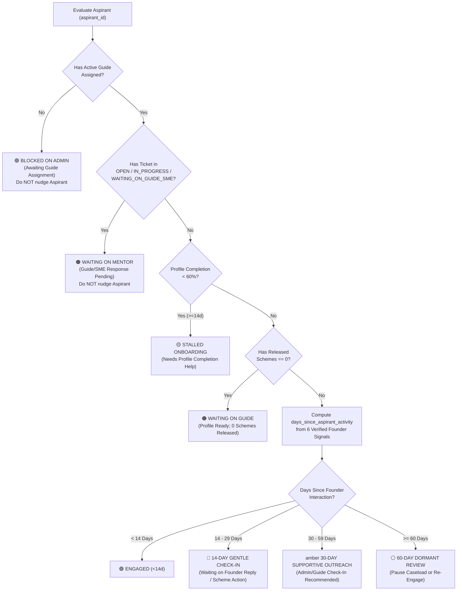

# FULCRUM-BETA → AGY ARGON: SUPPORTIVE ASPIRANT ENGAGEMENT MONITOR PROPOSAL
**Deliverable 6 of 10 | Mode: Read-Only Product Architecture & Design Proposal (Not Implemented)**

---

## 1. Product Philosophy: Why Aspirant Engagement Differs from Mentor Inactivity

In Fulcrum-Beta, **Guides** and **Domain SMEs** are institutional advisors bound by service-level expectations (`7-day` reminder, `10-day` Admin alert, `14-day` reassignment review in [`services/inactivity.py`](file:///c:/Users/hp/Desktop/Fulcrum-Alpha/fulcrum-cluster-b/services/inactivity.py)).

**Aspirants (entrepreneurs), by contrast, are voluntary founders building real businesses.** When an Aspirant has not interacted with Fulcrum for 2–8 weeks, it is **not** a compliance violation—it means one of four distinct realities:
1. **Blocked on Platform / Mentor Action:** The founder completed their profile or asked a question and is waiting on Admin to assign a Guide, waiting on their Guide to release schemes, or waiting on their Guide/SME to answer a consultation (`status IN ('OPEN', 'IN_PROGRESS', 'WAITING_ON_GUIDE_SME')`).
2. **Stalled at Onboarding:** The founder signed up (`completion_pct < 50%`) and got overwhelmed by the 26-field profile form.
3. **Action Needed From Founder:** A Guide or SME requested documents/clarification (`status == 'WAITING_ON_ASPIRANT'`) or released schemes (`scheme_releases.status == 'RELEASED'`), and the founder has not responded.
4. **Offline Execution / Dormancy:** The founder is busy running factory/field operations or waiting on an external bank/DIC sanction.

> [!IMPORTANT]
> **Core Design Rule:** An Aspirant Engagement Monitor must **never** flag or nudge an entrepreneur as "Inactive" if the ball is currently in Fulcrum's court (i.e., waiting on Admin assignment or waiting on Guide/SME response).

---

## 2. Engagement Signals & Current Database Availability Audit

We audited both the Supabase schema (`migrations/*.sql`) and Local SQLite ([`services/local_db.py`](file:///c:/Users/hp/Desktop/Fulcrum-Alpha/fulcrum-cluster-b/services/local_db.py)) to determine which Aspirant activity signals exist today without schema changes versus which require a migration:

| Signal Source | Table & Column | Authorship Verification | Currently Available in Supabase & SQLite? |
| :--- | :--- | :--- | :--- |
| **1. Venture Profile Update** | `profiles.updated_at` | Must exclude Admin co-edits if possible, or pair with `journey_events` (`event_type='profile_updated'`, `actor_role='aspirant'`) | ✅ **Yes** (`profiles.updated_at` + `journey_events`) |
| **2. Founder Journey Milestone** | `journey_events.created_at` | `WHERE aspirant_id = X AND actor_id = X AND actor_role = 'aspirant' AND deleted_at IS NULL` | ✅ **Yes** ([`services/journey.py`](file:///c:/Users/hp/Desktop/Fulcrum-Alpha/fulcrum-cluster-b/services/journey.py)) |
| **3. Consultation Created by Founder** | `help_requests.created_at` | `WHERE aspirant_id = X AND request_type = 'aspirant_consultation'` | ✅ **Yes** ([`services/help_requests.py`](file:///c:/Users/hp/Desktop/Fulcrum-Alpha/fulcrum-cluster-b/services/help_requests.py)) |
| **4. Consultation Reply by Founder** | `help_requests.last_aspirant_response_at` (or fallback `updated_at` when `last_interaction_actor_role = 'aspirant'`) | `WHERE aspirant_id = X AND last_interaction_actor_role = 'aspirant'` | ⚠️ **Partial:** Added to SQLite (`a360a50`), but `last_aspirant_response_at` is in `NEW_TRACKING_COLUMNS` ([`services/help_requests.py:L34`](file:///c:/Users/hp/Desktop/Fulcrum-Alpha/fulcrum-cluster-b/services/help_requests.py#L34)) and may require a non-destructive `ALTER TABLE` on Supabase if not yet applied. |
| **5. Case Discussion Message** | `case_discussions.created_at` | `WHERE aspirant_id = X AND author_id = X AND author_role = 'aspirant'` | ✅ **Yes** ([`services/collaboration.py`](file:///c:/Users/hp/Desktop/Fulcrum-Alpha/fulcrum-cluster-b/services/collaboration.py)) |
| **6. Legal / Terms Acceptance** | `legal_acceptances.accepted_at` | `WHERE user_id = X` | ✅ **Yes** ([`services/legal.py`](file:///c:/Users/hp/Desktop/Fulcrum-Alpha/fulcrum-cluster-b/services/legal.py)) |
| **7. Last Login Timestamp** | `auth.users.last_sign_in_at` (Supabase) / `users.last_login_at` (SQLite) | Passive login (even without writing data) | ⚠️ **Partial:** Available in SQLite `users.last_login_at` and Supabase `auth.admin.list_users()`, but **not** stored on `public.profiles`. |

---

## 3. Blocker-Aware Classification State Machine

Before calculating days since last Aspirant activity, the engine classifies each Aspirant into an **Engagement Context State**:

---

## 4. Proposed Supportive Check-In Thresholds (14 / 30 / 60 Days)

| Stage | Threshold | Target Audience | Tone & Action |
| :--- | :---: | :--- | :--- |
| **Stage 1: Gentle Check-In** | **14 Days** (and `status == WAITING_ON_ASPIRANT` or `completion_pct < 60%`) | Assigned Guide (In-App Badge) + Optional In-App Banner for Aspirant | *"Need a hand completing your profile or reviewing your schemes? Your Guide is available to help."* (Never automated WhatsApp/email). |
| **Stage 2: Supportive Outreach** | **30 Days** of no founder activity (while not blocked on mentor) | Admin (`Fulcrum Support`) & Assigned Guide | Surfaces pre-filled, courteous WhatsApp/Gmail draft (`"General check-in"` or `"Profile completion reminder"` from [`services/external_contact.py:L197`](file:///c:/Users/hp/Desktop/Fulcrum-Alpha/fulcrum-cluster-b/services/external_contact.py#L197)) for manual Admin or Guide outreach. |
| **Stage 3: Dormant Venture Review** | **60 Days** of no founder activity after Stage 2 follow-up | Single Platform Admin | Allows Admin to mark the venture's engagement status as `PAUSED / DORMANT` so the assigned Guide is not unfairly penalized by the 7/10/14-day Mentor Inactivity Scanner when an entrepreneur goes offline for months! |

> [!TIP]
> **Critical Synergy with Mentor Inactivity Scanner:** Right now, if an Aspirant goes completely offline for 45 days, the assigned Guide is forced to log artificial check-ins every 7 days just to prevent `services/inactivity.py` from escalating the Guide to the Admin at Day 10 and Day 14! Introducing a **`WAITING_ON_ASPIRANT` / `DORMANT_ASPIRANT` grace rule** prevents Guides from being penalized when the founder is unresponsive after a mentor check-in.

---

## 5. UI Placement Options Within Existing Tabs (No New Top-Level Tabs)

In accordance with Invariant 4 (no new pages or tab sprawl), we evaluated three placement options within existing screens:

| Criteria | **Option A: Sub-Toggle Inside Existing Admin Tab 6 (`Inactivity Monitor`)** | **Option B: Filter & Status Pill Inside Admin Tab 0 (`Aspirants & Journeys`) & Tab 11 (`Aspirant Photos & Outreach`)** | **Option C (Recommended Hybrid): Admin Tab 6 Sub-View + Guide Mentee Selector Badge** |
| :--- | :--- | :--- | :--- |
| **How It Works** | Adds a 2-pill switcher at the top of Admin Tab 6 (`Inactivity Monitor`): `🧭 Mentor SLA Monitor (7/10/14d)` vs `🌱 Founder Engagement & Blockers (14/30/60d)`. | Adds an engagement filter (`All`, `Stalled Onboarding`, `Waiting on Mentor`, `Inactive >30d`) to Admin Tab 0's Aspirant dropdown. | Combines **Option A** (Admin Tab 6 sub-switcher reusing existing WhatsApp/Gmail follow-up cards) with a lightweight status badge (`🟢 Active`, `🟡 Waiting on You`, `⏳ 21d quiet`) in the Guide's Mentee selector (`views/guide.py:L100`). |
| **UI Footprint** | Zero new top-level tabs; reuses 100% of Tab 6's `external_contact.py` WhatsApp/Gmail draft infrastructure. | Zero new top-level tabs, but crowds Tab 0 which is already a dossier viewer/editor. | Zero new top-level tabs; puts triage in Tab 6 for Admin and awareness in Tab 0 for Guides. |
| **Cognitive Load** | Low (separates Mentor SLA alerts from Founder supportive check-ins). | Medium (mixes profile editing with inactivity outreach). | Lowest (each role sees engagement health exactly where they triage). |
| **Recommendation** | Good for Admin alone. | Too hidden for daily triage. | ⭐ **RECOMMENDED** |

---

## 6. Ten Required Owner Decisions for Aspirant Engagement Monitoring

Before any code is written for this feature, please review and decide on the following 10 product questions (also logged in Deliverable 10 `ARGON_OWNER_DECISION_AND_APPROVAL_REGISTER.md`):

1. **Thresholds:** Do you approve the **14 / 30 / 60-day** thresholds for Aspirant check-ins (vs the 7 / 10 / 14-day thresholds used for Guides/SMEs)? *(Recommended: Yes — 14d, 30d, 60d).*
2. **Blocker Immunity:** Should Aspirants who are currently waiting on Admin (no Guide assigned) or waiting on a Guide/SME reply (`OPEN` / `IN_PROGRESS` / `WAITING_ON_GUIDE_SME`) be **excluded** from being flagged as "Inactive Aspirants" and instead shown as `"Waiting on Fulcrum / Mentor"`? *(Recommended: Yes).*
3. **Mentor Inactivity Grace Period When Waiting on Aspirant:** If a Guide or SME has issued a check-in or replied to a ticket (`status = WAITING_ON_ASPIRANT`) and the Aspirant has not responded yet, should the Mentor's 7/10/14-day inactivity clock pause or extend (e.g., to 14 days) so mentors are not penalized for founder silence? *(Recommended: Yes — pause/extend mentor clock when last interaction was by the mentor and status is `WAITING_ON_ASPIRANT`).*
4. **Who Performs 30-Day Outreach:** Should 30-day supportive check-ins be initiated by the **Assigned Guide** (via in-app directive) or by **Fulcrum Support (Admin)** (via manual WhatsApp/Gmail draft), or both? *(Recommended: Assigned Guide at Day 14 in-app; Fulcrum Support manual WhatsApp/Gmail option at Day 30).*
5. **UI Placement:** Do you prefer **Option A** (Admin Tab 6 sub-view only), **Option B** (Admin Tab 0 filter), or **Option C** (Admin Tab 6 sub-view + Guide Mentee dropdown indicator)? *(Recommended: Option C).*
6. **Passive Login Tracking:** Should logging into the platform (without editing the profile or posting a message) count as "Aspirant Activity", or should only meaningful venture actions (profile update, milestone, consultation, reply) reset the engagement clock? *(Recommended: Track both, showing "Last Login" separately from "Last Venture Action").*
7. **Dormant / Paused Caseload Status (60+ Days):** At 60+ days of no response after follow-up, should Admin have a non-destructive `"Mark Venture as Dormant / Paused"` toggle on the relationship so it stops generating recurring inactivity alerts until the Aspirant returns? *(Recommended: Yes).*
8. **Onboarding Incomplete Nudge:** If a newly registered Aspirant remains below `50%` profile completion for 7+ days, should they see a gentle step-by-step completion banner on their Overview tab? *(Recommended: Yes).*
9. **Database Schema Impact:** Should Aspirant engagement states be computed **dynamically on-the-fly** from existing tables (`profiles`, `journey_events`, `help_requests`, `case_discussions`, `external_contact_logs` — zero new tables required), or persisted into `inactivity_logs` with `actor_role='aspirant'`? *(Recommended: Compute dynamically on-the-fly + reuse `external_contact_logs` for follow-up audit — zero schema migration required).*
10. **Aspirant Visibility:** Should the Aspirant ever see an "Inactivity" label on their own dashboard, or should all Aspirant-facing copy strictly use supportive language (`"Next Recommended Step"`, `"Your Guide Checked In"`)? *(Recommended: Strictly supportive language; never show "Inactive" badges to Aspirants).*
