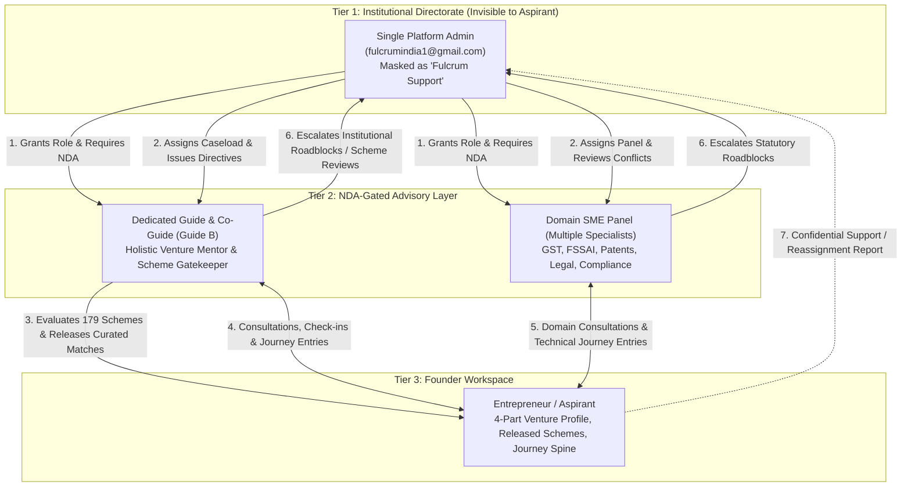

# FULCRUM-BETA → AGY ARGON: PROJECT UNDERSTANDING & PRODUCT ARCHITECTURE
**Deliverable 1 of 10 | Mode: Read-Only System Understanding & Diagnostics**  
**Source Inspected:** `Fulcrum-Beta-main (3).zip` + `security/phase0-containment` branch (`a360a50`)

---

## 1. Executive Mission & Institutional Model

**Fulcrum-India (Cluster A)** is a two-tier institutional entrepreneurship mentoring, government scheme intelligence, and venture milestone tracking platform designed for grassroots and MSME founders (primarily across Tamil Nadu and India).

Unlike self-serve directories or open social networks, Fulcrum enforces a **curated, human-in-the-loop institutional governance model**:
1. **No Unfiltered Scheme Dumping:** Entrepreneurs (**Aspirants**) do not see raw algorithmic matches or internal grant evaluation criteria. Instead, a deterministic AI/rules matching engine ([`services/scheme_matching_engine.py`](file:///c:/Users/hp/Desktop/Fulcrum-Alpha/fulcrum-cluster-b/services/scheme_matching_engine.py)) evaluates 179 central/state schemes against the founder's profile, and the assigned **Guide** acts as the human gatekeeper who reviews, annotates, and releases curated opportunities ([`release_scheme_to_aspirant`](file:///c:/Users/hp/Desktop/Fulcrum-Alpha/fulcrum-cluster-b/services/schemes.py#L370-L496)).
2. **Two-Tier Anonymized Directorate:** The single **Platform Admin** (`fulcrumindia1@gmail.com`) is completely invisible to Aspirants. Whenever administrative actions appear in Aspirant-facing timelines or notifications, the Admin is masked as **"Fulcrum Support"** or **"Institutional Advisory Council"** ([`get_masked_actor_name`](file:///c:/Users/hp/Desktop/Fulcrum-Alpha/fulcrum-cluster-b/services/governance.py#L41-L52), [`get_standard_role_label`](file:///c:/Users/hp/Desktop/Fulcrum-Alpha/fulcrum-cluster-b/services/journey.py#L84-L104)).
3. **Chronological Venture Spine ("The Entrepreneur's Movie"):** Every meaningful milestone—profile updates, Guide assignments, scheme releases, SME technical interventions, and founder achievements—is recorded on a unified chronological timeline ([`services/journey.py`](file:///c:/Users/hp/Desktop/Fulcrum-Alpha/fulcrum-cluster-b/services/journey.py)).

---

## 2. The Four Core Roles & Multi-Role Identity Architecture

Fulcrum enforces **One Supabase Auth UUID per Natural Person** ([`services/auth.py`](file:///c:/Users/hp/Desktop/Fulcrum-Alpha/fulcrum-cluster-b/services/auth.py), [`services/roles.py`](file:///c:/Users/hp/Desktop/Fulcrum-Alpha/fulcrum-cluster-b/services/roles.py)):

| Role | Who They Are | Core Responsibilities & Boundaries |
| :--- | :--- | :--- |
| **Aspirant** (`aspirant`) | Grassroots entrepreneur, student founder, or MSME owner. | Completes the 4-section Naukri/LinkedIn-style venture dossier + Strategic Assistance Need; views **only** Guide-released schemes (never sees Insider Intelligence, Red Flags, or AI Pitch Prompts); logs personal Journey milestones and toggles roadmap inclusion; raises targeted Consultations to assigned Guide/SMEs; files confidential support/reassignment reports. |
| **Guide** (`guide`) | Certified generalist business mentor (and optional Co-Guide / Guide B). | Must sign Terms & Conditions + Role NDA before accessing caseload. Reviews assigned Aspirants' profiles and photographs; runs the 179-scheme matching engine; inspects private Insider Intelligence, Red Flags, and AI Copilot Prompts; releases or withdraws schemes; escalates borderline schemes to Admin via Scheme Support Reviews; logs Guide Journey entries; responds to or initiates Consultations; escalates institutional roadblocks to Admin; posts private mentor notes. |
| **Domain SME** (`sme`) | Subject Matter Expert (GST, FSSAI, Patents/IPR, Company Law, Exports). | Must sign Terms & Conditions + Role NDA before accessing caseload. Assigned to an Aspirant's multi-specialist Advisory Panel (`sme_ids`). Reviews assigned Aspirant profiles, photographs, and Journeys; logs technical domain contributions to the Journey; responds to or initiates domain Consultations; escalates statutory roadblocks to Admin; declares Conflicts of Interest. **Never** sees or releases funding schemes. |
| **Platform Admin** (`admin`) | Strictly ONE account: `fulcrumindia1@gmail.com` (`616304b5-aef5-4cd0-88be-2fda7ddf7f88`). | Full platform governance across 12 tabs: inspects all Aspirants & Journeys; provisions accounts; views Guides/SMEs directory; assigns/replaces/unassigns Guides, Co-Guides, and SMEs; issues official Mentor Directives and decides Scheme Support Reviews; manages the 179-scheme catalogue (CRUD/archive); monitors 7/10/14-day Guide & SME inactivity with WhatsApp/Gmail follow-up; manages multi-role grants (Grant/Suspend/Reinstate/Revoke); resolves Confidential Complaints; audits Legal/NDA acceptances and SME Conflicts; manages Aspirant Photos and direct Aspirant outreach. **Never** holds a hybrid role and is excluded from all mentor candidate lists. |

### Multi-Role Combinations & Isolation
- Any natural person (except Admin) may hold any of the **7 non-Admin role combinations**:
  1. `Aspirant`
  2. `Guide`
  3. `SME`
  4. `Aspirant + Guide`
  5. `Aspirant + SME`
  6. `Guide + SME`
  7. `Aspirant + Guide + SME`
- **Self-Assignment Guard:** [`assign_guide`](file:///c:/Users/hp/Desktop/Fulcrum-Alpha/fulcrum-cluster-b/services/relationships.py#L196-L197) and [`assign_sme`](file:///c:/Users/hp/Desktop/Fulcrum-Alpha/fulcrum-cluster-b/services/relationships.py#L414-L415) explicitly block `str(aspirant_id) == str(mentor_id)` so a hybrid `Aspirant + Guide` or `Aspirant + SME` can never be assigned to mentor their own venture.
- **Role Switcher:** Rendered in [`app.py`](file:///c:/Users/hp/Desktop/Fulcrum-Alpha/fulcrum-cluster-b/app.py#L902-L980) when a user has >1 active or `pending_nda` role. Switching roles updates `st.session_state.active_role` and `st.session_state.role`.

---

## 3. End-to-End Lifecycle & Subsystem Mechanics

### 3.1 How a New Aspirant Progresses Through Fulcrum
1. **Onboarding & Legal Gate:** Aspirant registers via self-signup ([`views/login.py`](file:///c:/Users/hp/Desktop/Fulcrum-Alpha/fulcrum-cluster-b/views/login.py)) or Admin provisioning ([`views/admin.py` Tab 1](file:///c:/Users/hp/Desktop/Fulcrum-Alpha/fulcrum-cluster-b/views/admin.py#L350-L535)). Upon first login, [`render_terms_and_conditions_gate`](file:///c:/Users/hp/Desktop/Fulcrum-Alpha/fulcrum-cluster-b/views/legal_ui.py#L19-L90) blocks workspace access until the user types `"I ACCEPT"` and signs the SHA-256 hashed Terms & Conditions (`v1.0.0`).
2. **Venture Dossier & Photo Upload:** In [`views/aspirant.py` Tab 1](file:///c:/Users/hp/Desktop/Fulcrum-Alpha/fulcrum-cluster-b/views/aspirant.py#L195-L470), the Aspirant uploads their profile photograph ([`save_aspirant_photo`](file:///c:/Users/hp/Desktop/Fulcrum-Alpha/fulcrum-cluster-b/services/aspirant_photos.py)) and completes 4 sections (Personal, Professional, Business, Demographics) plus their **Strategic Assistance Requirement** (Goal, Capital Type, Quantum Bracket, Urgency). Saving triggers [`update_aspirant_profile`](file:///c:/Users/hp/Desktop/Fulcrum-Alpha/fulcrum-cluster-b/services/profiles.py#L256-L396), which recalculates completion percentage (`0–100%`), updates the `journeys` record, and logs a `"Business Profile Updated"` event on the Journey spine.
3. **Mentor Allocation:** The Admin assigns a primary Guide (and optionally Co-Guide / Domain SMEs) in [`views/admin.py` Tab 3](file:///c:/Users/hp/Desktop/Fulcrum-Alpha/fulcrum-cluster-b/views/admin.py#L596-L730). Both the Mentor and Aspirant receive in-app notifications, an immutable row is written to `assignment_history`, and a Journey event (`guide_assigned` / `sme_assigned`) is logged.
4. **Scheme Evaluation & Release:** The assigned Guide opens [`views/guide.py` Subtab 2 (`Scheme Matches`)](file:///c:/Users/hp/Desktop/Fulcrum-Alpha/fulcrum-cluster-b/views/guide.py#L202-L315), reviews the deterministic match scores (`0–100%`) and statutory checklists from [`match_aspirant_schemes_intelligent`](file:///c:/Users/hp/Desktop/Fulcrum-Alpha/fulcrum-cluster-b/services/scheme_matching_engine.py), adds a custom Guide Recommendation Note, and clicks **Release Scheme to Aspirant**. If a scheme fails a hard gatekeeper rule (`is_disqualified=True`), the Guide can either check the verification override or escalate it to Admin via **Request Fulcrum Support Review** ([`submit_scheme_support_review`](file:///c:/Users/hp/Desktop/Fulcrum-Alpha/fulcrum-cluster-b/services/scheme_reviews.py#L18-L97)).
5. **Advisory Execution & Milestone Tracking:** The Aspirant views released schemes in [`views/aspirant.py` Tab 2](file:///c:/Users/hp/Desktop/Fulcrum-Alpha/fulcrum-cluster-b/views/aspirant.py#L475-L500), collaborates with their Guide and SMEs via Consultations (`help_requests`) and Case Discussions (`case_discussions`), and tracks every milestone on their chronological Journey (`journey_events`).

---

## 4. Deep-Dive Feature Anatomy (Answering the 12 Core Questions per Feature System)

### System 1: Authentication, Session Management & Password Recovery
- **Files:** [`services/auth.py`](file:///c:/Users/hp/Desktop/Fulcrum-Alpha/fulcrum-cluster-b/services/auth.py), [`views/login.py`](file:///c:/Users/hp/Desktop/Fulcrum-Alpha/fulcrum-cluster-b/views/login.py), [`app.py`](file:///c:/Users/hp/Desktop/Fulcrum-Alpha/fulcrum-cluster-b/app.py)
1. **Why it exists:** Authenticates users against Supabase Auth (primary) or explicit local SQLite (`DATA_BACKEND=sqlite`), establishes role context, and provides self-service password reset.
2. **Who uses it:** All 4 roles (`aspirant`, `guide`, `sme`, `admin`).
3. **Trigger:** Login form submission, Signup form submission, Forgot Password recovery flow, or URL query parameters (`?code=` / `?token_hash=`).
4. **Inputs:** Email, password, full name, phone, district, or Supabase recovery OTP/token.
5. **Validation:** Email format, password length (`>= 6` chars), account active check (`is_active != False`), and token verification via `client.auth.verify_otp` / `exchange_code_for_session` ([`verify_recovery_token_and_update_password`](file:///c:/Users/hp/Desktop/Fulcrum-Alpha/fulcrum-cluster-b/services/auth.py#L565-L635)).
6. **Service functions:** [`login_user`](file:///c:/Users/hp/Desktop/Fulcrum-Alpha/fulcrum-cluster-b/services/auth.py#L229-L360), [`signup_aspirant`](file:///c:/Users/hp/Desktop/Fulcrum-Alpha/fulcrum-cluster-b/services/auth.py#L362-L455), [`admin_create_mentor`](file:///c:/Users/hp/Desktop/Fulcrum-Alpha/fulcrum-cluster-b/services/auth.py#L457-L563), [`send_password_reset_email`](file:///c:/Users/hp/Desktop/Fulcrum-Alpha/fulcrum-cluster-b/services/auth.py#L530-L563), [`verify_recovery_token_and_update_password`](file:///c:/Users/hp/Desktop/Fulcrum-Alpha/fulcrum-cluster-b/services/auth.py#L565-L635).
7. **Tables read/written:** `auth.users` (Supabase Auth), `profiles`, `journeys`, `journey_events`, `user_roles`.
8. **Notifications:** Welcome Journey event on signup; no in-app notification on login.
9. **Audit/Journey records:** Initial `"Joined Fulcrum-India"` event created in `journey_events` upon Aspirant registration.
10. **UI updates:** Populates `st.session_state.user`, `user_id`, `role`, `active_role` and reruns into the gated workspace.
11. **Failure/Edge cases:** In Phase 0 (`SEC-02`), the unauthenticated direct-email password reset bypass was removed; production password resets now strictly require a valid Supabase recovery token or authenticated session.
12. **Completeness:** **Working & Hardened** (minor UX gap: Supabase redirect URL configuration must match deployment domain for seamless recovery token capture).

### System 2: Multi-Role Grants, NDA Gating & Legal Audit
- **Files:** [`services/roles.py`](file:///c:/Users/hp/Desktop/Fulcrum-Alpha/fulcrum-cluster-b/services/roles.py), [`services/legal.py`](file:///c:/Users/hp/Desktop/Fulcrum-Alpha/fulcrum-cluster-b/services/legal.py), [`views/legal_ui.py`](file:///c:/Users/hp/Desktop/Fulcrum-Alpha/fulcrum-cluster-b/views/legal_ui.py), [`views/admin_governance.py`](file:///c:/Users/hp/Desktop/Fulcrum-Alpha/fulcrum-cluster-b/views/admin_governance.py)
1. **Why it exists:** Allows one natural person to hold multiple non-Admin roles while enforcing mandatory Terms & Conditions (`terms_and_conditions`) for all users and role-specific NDAs (`nda_dual`) before any Guide or SME can access entrepreneur data.
2. **Who uses it:** Admin grants/suspends/revokes roles; Aspirants/Guides/SMEs sign legal gates and switch roles in the sidebar.
3. **Trigger:** Admin clicks Grant/Suspend/Reinstate/Revoke in Tab 7 (`Role Grants & Multi-Role`); user logs in or switches to a `pending_nda` role.
4. **Inputs:** Target `user_id`, `role` (`guide` or `sme`), `require_nda` boolean, revocation/suspension reason; user's typed legal name, `"I ACCEPT"` phrase, and checkbox.
5. **Validation:** Blocks granting `admin`; blocks revoking/suspending base `aspirant` role; verifies exact `"I ACCEPT"` phrase and SHA-256 document hash.
6. **Service functions:** [`grant_role`](file:///c:/Users/hp/Desktop/Fulcrum-Alpha/fulcrum-cluster-b/services/roles.py#L118-L180), [`activate_role`](file:///c:/Users/hp/Desktop/Fulcrum-Alpha/fulcrum-cluster-b/services/roles.py#L182-L212), [`suspend_role`](file:///c:/Users/hp/Desktop/Fulcrum-Alpha/fulcrum-cluster-b/services/roles.py#L273-L305), [`reinstate_role`](file:///c:/Users/hp/Desktop/Fulcrum-Alpha/fulcrum-cluster-b/services/roles.py#L307-L336), [`revoke_role`](file:///c:/Users/hp/Desktop/Fulcrum-Alpha/fulcrum-cluster-b/services/roles.py#L214-L270), [`record_legal_acceptance`](file:///c:/Users/hp/Desktop/Fulcrum-Alpha/fulcrum-cluster-b/services/legal.py#L360-L465).
7. **Tables read/written:** `user_roles`, `legal_documents`, `legal_acceptances`, `relationships` (auto-unassigns caseload on role revocation).
8. **Notifications:** Auto-unassignment on role revocation triggers `guide_unassigned` / `sme_unassigned` notifications; however, **granting, suspending, or reinstating a role does NOT currently send an in-app notification to the user**.
9. **Audit/Journey records:** Immutable row in `legal_acceptances` with `doc_hash`, `typed_legal_name`, `accepted_at`; `user_roles` tracks `granted_at`, `activated_at`, `suspended_at`, `revoked_at`.
10. **UI updates:** Sidebar shows `⏳ NDA Required` badge until signed; signing immediately activates the role and opens the mentor portal.
11. **Failure/Edge cases:**
    - **Defect 1:** In [`views/admin_governance.py:L138`](file:///c:/Users/hp/Desktop/Fulcrum-Alpha/fulcrum-cluster-b/views/admin_governance.py#L138), `grants = [r for r in u.get("role_grants", []) if r.get("role") != primary_r]` hides a user's primary role if they were provisioned directly as a standalone Guide or SME—meaning Admin cannot suspend or revoke a standalone Guide/SME!
    - **Defect 2:** [`suspend_role`](file:///c:/Users/hp/Desktop/Fulcrum-Alpha/fulcrum-cluster-b/services/roles.py#L273-L305) suspends the role in `user_roles`, which hides the caseload from the mentor (`get_assigned_aspirants_for_guide` checks `user_has_active_role`), **but** the Aspirant's "My Mentors" view still shows the suspended mentor as active because `get_aspirant_mentors` does not filter out suspended mentors, and open tickets remain assigned to the suspended mentor!
12. **Completeness:** **Partially Complete** (requires fixing standalone mentor suspension/revocation, suspended mentor caseload indicators, and role-lifecycle notifications).

### System 3: 4-Section Venture Profile, Strategic Assistance & Aspirant Photographs
- **Files:** [`services/profiles.py`](file:///c:/Users/hp/Desktop/Fulcrum-Alpha/fulcrum-cluster-b/services/profiles.py), [`services/aspirant_photos.py`](file:///c:/Users/hp/Desktop/Fulcrum-Alpha/fulcrum-cluster-b/services/aspirant_photos.py), [`views/aspirant.py`](file:///c:/Users/hp/Desktop/Fulcrum-Alpha/fulcrum-cluster-b/views/aspirant.py), [`views/admin.py`](file:///c:/Users/hp/Desktop/Fulcrum-Alpha/fulcrum-cluster-b/views/admin.py), [`views/admin_governance.py`](file:///c:/Users/hp/Desktop/Fulcrum-Alpha/fulcrum-cluster-b/views/admin_governance.py)
1. **Why it exists:** Captures structured venture data for deterministic scheme matching and stores private founder identity photographs for authorized mentor/Admin verification.
2. **Who uses it:** Aspirant (owner), Admin (co-editor/manager), Assigned Guide & Assigned SME (read-only viewers).
3. **Trigger:** Saving profile forms or uploading/replacing/removing a JPG/PNG/WEBP photo.
4. **Inputs:** 4 JSON profile sections + `assistance_need` dict; image bytes (`<= 5 MB`, validated via magic bytes).
5. **Validation:** Role/ownership check in [`update_aspirant_profile`](file:///c:/Users/hp/Desktop/Fulcrum-Alpha/fulcrum-cluster-b/services/profiles.py#L275-L290); strict viewer authorization in [`can_view_aspirant_photo`](file:///c:/Users/hp/Desktop/Fulcrum-Alpha/fulcrum-cluster-b/services/aspirant_photos.py#L46-L103) (blocks unassigned mentors and foreign aspirants).
6. **Service functions:** [`get_profile`](file:///c:/Users/hp/Desktop/Fulcrum-Alpha/fulcrum-cluster-b/services/profiles.py#L67-L118), [`update_aspirant_profile`](file:///c:/Users/hp/Desktop/Fulcrum-Alpha/fulcrum-cluster-b/services/profiles.py#L256-L396), [`save_aspirant_photo`](file:///c:/Users/hp/Desktop/Fulcrum-Alpha/fulcrum-cluster-b/services/aspirant_photos.py), [`get_aspirant_photo`](file:///c:/Users/hp/Desktop/Fulcrum-Alpha/fulcrum-cluster-b/services/aspirant_photos.py).
7. **Tables read/written:** `profiles`, `journeys`, `journey_events`, `aspirant_photos`.
8. **Notifications:** None on profile/photo update.
9. **Audit/Journey records:** Logs `profile_updated` on the Journey timeline.
10. **UI updates:** Updates completion progress bar, refreshes scheme match cache, renders circular avatar header.
11. **Failure/Edge cases:**
    - **Defect 1 (Broken Photo Call Sites):** After Phase 0 hardened `get_aspirant_photo()` to require `viewer_id`, three call sites (`views/aspirant.py:L209`, `views/admin.py:L217`, `views/admin_governance.py:L673`) still call `get_aspirant_photo(id)` without `viewer_id`, causing them to return `None` and show the fallback avatar instead of the uploaded photo!
    - **Defect 2 (Unreactive `"Other"` Fields Inside `st.form`):** In `views/aspirant.py`, `views/admin.py`, and `views/guide.py`, selecting `"Other (Specify)"` on dropdowns inside `st.form` does not display the custom text input until after the form is submitted.
12. **Completeness:** **Broken in 3 Photo Call Sites & Degraded Form UX**.

### System 4: Mentor Assignment, Co-Guides, Multi-SME Panels & Handover
- **Files:** [`services/relationships.py`](file:///c:/Users/hp/Desktop/Fulcrum-Alpha/fulcrum-cluster-b/services/relationships.py), [`views/admin.py` Tab 3](file:///c:/Users/hp/Desktop/Fulcrum-Alpha/fulcrum-cluster-b/views/admin.py#L596-L730)
1. **Why it exists:** Connects each Aspirant with an institutional Guide (plus optional Co-Guide `guide_b`) and a panel of Domain SMEs (`sme_ids`) under strict Admin authority.
2. **Who uses it:** Admin assigns/replaces/unassigns; Aspirants, Guides, and SMEs view their team.
3. **Trigger:** Admin submits assignment form, replacement popover, unassign popover, or issues an Admin Directive with Co-Guide/SME attachment.
4. **Inputs:** `aspirant_id`, `guide_id` / `sme_id`, `mode` (`replace` or `add`), `notes` / `reason`.
5. **Validation:** Blocks self-assignment; verifies target holds active `guide` or `sme` role; checks SME conflict declarations in Admin UI.
6. **Service functions:** [`assign_guide`](file:///c:/Users/hp/Desktop/Fulcrum-Alpha/fulcrum-cluster-b/services/relationships.py#L178-L401), [`assign_sme`](file:///c:/Users/hp/Desktop/Fulcrum-Alpha/fulcrum-cluster-b/services/relationships.py#L403-L575), [`unassign_guide`](file:///c:/Users/hp/Desktop/Fulcrum-Alpha/fulcrum-cluster-b/services/relationships.py#L577-L716), [`unassign_sme`](file:///c:/Users/hp/Desktop/Fulcrum-Alpha/fulcrum-cluster-b/services/relationships.py#L718-L857), [`get_aspirant_mentors`](file:///c:/Users/hp/Desktop/Fulcrum-Alpha/fulcrum-cluster-b/services/relationships.py#L43-L176).
7. **Tables read/written:** `relationships`, `assignment_history`, `help_requests` (transfers `OPEN`/`IN_PROGRESS` tickets on replacement/unassignment), `journey_events`, `notifications`.
8. **Notifications:** Dispatches notifications to outgoing mentor, incoming mentor, and Aspirant.
9. **Audit/Journey records:** Writes `ASSIGNED`, `REPLACED`, or `UNASSIGNED` to `assignment_history` and logs Journey events (`guide_assigned`, `guide_reassigned`, `guide_unassigned`, `sme_assigned`, `sme_reassigned`, `sme_unassigned`).
10. **UI updates:** Invalidates `mentors:{aspirant_id}` and `guide_aspirants`/`sme_aspirants` caches.
11. **Failure/Edge cases:**
    - **Defect 1 (Co-Guides Hidden in Guidance Team Cards):** `views/aspirant.py:L642`, `views/guide.py:L381`, and `views/sme.py:L326` only render `mentors.get("guide")` (the single primary Guide) and ignore `mentors.get("guides")` / `guide_b`. Any Co-Guide assigned by Admin is invisible in the Guidance Team UI!
    - **Defect 2 (Ticket Handover Misses `WAITING_ON_*` Statuses):** When a Guide or SME is replaced or unassigned, `relationships.py` only transfers tickets with `status IN ('OPEN', 'IN_PROGRESS')` (`L269, L633, L774`), leaving `WAITING_ON_ASPIRANT` and `WAITING_ON_GUIDE_SME` tickets orphaned on the old mentor!
12. **Completeness:** **Partially Complete** (requires rendering Co-Guides in Guidance Team views and including `WAITING_ON_*` statuses in ticket handover).

### System 5: Scheme Catalogue, Deterministic Matching, Gatekeeper Release & Support Reviews
- **Files:** [`services/schemes.py`](file:///c:/Users/hp/Desktop/Fulcrum-Alpha/fulcrum-cluster-b/services/schemes.py), [`services/scheme_matching_engine.py`](file:///c:/Users/hp/Desktop/Fulcrum-Alpha/fulcrum-cluster-b/services/scheme_matching_engine.py), [`services/schemes_ui.py`](file:///c:/Users/hp/Desktop/Fulcrum-Alpha/fulcrum-cluster-b/services/schemes_ui.py), [`services/scheme_reviews.py`](file:///c:/Users/hp/Desktop/Fulcrum-Alpha/fulcrum-cluster-b/services/scheme_reviews.py)
1. **Why it exists:** Matches Aspirants to 179 government/institutional funding schemes using explainable criteria while keeping insider evaluation intelligence private to Guides and Admin.
2. **Who uses it:** Admin (manages 179 schemes & decides Support Reviews), Guide (evaluates matches, views Insider Intel/Red Flags/AI Prompts, releases/withdraws schemes, requests Support Reviews), Aspirant (views released schemes & previews locked matches).
3. **Trigger:** Profile update, Guide opening Scheme Matches subtab, Guide clicking Release/Withdraw/Request Support Review, Admin approving/rejecting Support Review.
4. **Inputs:** Founder profile + `assistance_need`, Guide recommendation note, override confirmation, or Support Review justification.
5. **Validation:** Gatekeeper check blocks releasing disqualified schemes unless `allow_disqualified_override=True`; sanitizes `hidden_agenda`, `red_flags`, and `application_prompt` out of [`get_released_schemes_for_aspirant`](file:///c:/Users/hp/Desktop/Fulcrum-Alpha/fulcrum-cluster-b/services/schemes.py#L573-L685).
6. **Service functions:** [`list_schemes`](file:///c:/Users/hp/Desktop/Fulcrum-Alpha/fulcrum-cluster-b/services/schemes.py#L32-L128), [`match_schemes_for_aspirant`](file:///c:/Users/hp/Desktop/Fulcrum-Alpha/fulcrum-cluster-b/services/schemes.py#L236-L295), [`release_scheme_to_aspirant`](file:///c:/Users/hp/Desktop/Fulcrum-Alpha/fulcrum-cluster-b/services/schemes.py#L370-L496), [`withdraw_scheme_release`](file:///c:/Users/hp/Desktop/Fulcrum-Alpha/fulcrum-cluster-b/services/schemes.py#L498-L571), [`submit_scheme_support_review`](file:///c:/Users/hp/Desktop/Fulcrum-Alpha/fulcrum-cluster-b/services/scheme_reviews.py#L18-L97), [`decide_scheme_support_review`](file:///c:/Users/hp/Desktop/Fulcrum-Alpha/fulcrum-cluster-b/services/scheme_reviews.py#L154-L227).
7. **Tables read/written:** `schemes`, `scheme_releases`, `scheme_support_reviews`, `journey_events`, `notifications`.
8. **Notifications:** Notifies Aspirant on scheme release; notifies Admin on Support Review request; notifies Guide on Support Review decision. (**Note:** Withdrawing a scheme release logs a Journey event but does **not** send a notification to the Aspirant).
9. **Audit/Journey records:** Logs `scheme_released` and `scheme_release_withdrawn` on the Journey timeline.
10. **UI updates:** Moves scheme into "Released to Aspirant" list and renders Fund Explorer cards.
11. **Failure/Edge cases:**
    - **Defect 1 (Co-Guide Cannot Release Schemes):** [`release_scheme_to_aspirant`](file:///c:/Users/hp/Desktop/Fulcrum-Alpha/fulcrum-cluster-b/services/schemes.py#L386-L391) and [`withdraw_scheme_release`](file:///c:/Users/hp/Desktop/Fulcrum-Alpha/fulcrum-cluster-b/services/schemes.py#L510-L515) check `str(assigned_guide.get("id")) != str(guide_id)` (only the primary Guide!), blocking an authorized Co-Guide (`guide_b`) from releasing or withdrawing schemes!
    - **Defect 2 (Cache Invalidation Missing on Scheme CRUD):** [`upsert_scheme`](file:///c:/Users/hp/Desktop/Fulcrum-Alpha/fulcrum-cluster-b/services/schemes.py#L157-L183), [`toggle_archive_scheme`](file:///c:/Users/hp/Desktop/Fulcrum-Alpha/fulcrum-cluster-b/services/schemes.py#L185-L215), and [`delete_scheme`](file:///c:/Users/hp/Desktop/Fulcrum-Alpha/fulcrum-cluster-b/services/schemes.py#L217-L234) do **not** call `invalidate_global_cache("schemes:all_active")`, so Admin edits/archives take up to 5 minutes (TTL=300s) to appear!
    - **Defect 3 (No Application Outcome Tracking):** Once a scheme is `RELEASED`, there is no state transition for the Aspirant or Guide to track `PREPARING_APPLICATION` → `APPLIED` → `SANCTIONED` / `REJECTED`.
12. **Completeness:** **Working Core with 3 Operational Gaps** (Co-Guide authorization, global cache invalidation on scheme edit, and post-release application tracking).

### System 6: Chronological Journey Timeline, Revisions & Roadmap Inclusion
- **Files:** [`services/journey.py`](file:///c:/Users/hp/Desktop/Fulcrum-Alpha/fulcrum-cluster-b/services/journey.py), [`views/journey_edit_dialog.py`](file:///c:/Users/hp/Desktop/Fulcrum-Alpha/fulcrum-cluster-b/views/journey_edit_dialog.py)
1. **Why it exists:** Maintains an auditable, chronological narrative spine of the entrepreneur's progress across all actors.
2. **Who uses it:** Aspirant, Guide, SME, and Admin.
3. **Trigger:** Manual milestone creation (`add_manual_aspirant_entry`, `add_guide_contribution`, `add_sme_contribution`), modal edits (`update_journey_event`), soft deletion (`soft_delete_event`), roadmap inclusion toggle (`toggle_event_roadmap_inclusion`), or automated system events.
4. **Inputs:** Title, description, category/domain, date, optional URL link, roadmap inclusion boolean, edit reason.
5. **Validation:** Strict authorship check (`can_user_edit_event` / `soft_delete_event` — only the original author in their role or Admin can edit/delete); only the owning Aspirant can toggle `included_in_roadmap` ([`toggle_event_roadmap_inclusion`](file:///c:/Users/hp/Desktop/Fulcrum-Alpha/fulcrum-cluster-b/services/journey.py#L244-L370)).
6. **Service functions:** [`get_journey_timeline`](file:///c:/Users/hp/Desktop/Fulcrum-Alpha/fulcrum-cluster-b/services/journey.py#L156-L242), [`add_manual_aspirant_entry`](file:///c:/Users/hp/Desktop/Fulcrum-Alpha/fulcrum-cluster-b/services/journey.py#L371-L446), [`add_guide_contribution`](file:///c:/Users/hp/Desktop/Fulcrum-Alpha/fulcrum-cluster-b/services/journey.py#L448-L530), [`add_sme_contribution`](file:///c:/Users/hp/Desktop/Fulcrum-Alpha/fulcrum-cluster-b/services/journey.py#L532-L615), [`update_journey_event`](file:///c:/Users/hp/Desktop/Fulcrum-Alpha/fulcrum-cluster-b/services/journey.py), [`soft_delete_event`](file:///c:/Users/hp/Desktop/Fulcrum-Alpha/fulcrum-cluster-b/services/journey.py).
7. **Tables read/written:** `journeys`, `journey_events`, `journey_event_revisions`.
8. **Notifications:** Guide and SME Journey contributions reset mentor inactivity clocks, but do **not** currently send an in-app notification to the Aspirant.
9. **Audit/Journey records:** Edits record snapshots in `journey_event_revisions`; deletions are soft-deletes (`deleted_at`, `deleted_by`, `deleted_by_role`).
10. **UI updates:** Immediately re-sorts timeline (`sort_journey_events`) with same-day tie-breaking.
11. **Failure/Edge cases:** `add_manual_aspirant_entry`, `add_guide_contribution`, and `add_sme_contribution` do not explicitly call `invalidate_memo(f"journey:{aspirant_id}")` before returning (they rely on `st.rerun()` clearing or reusing session memo, which is a 60s TTL cache—meaning in warm sessions without cache invalidation, newly added entries can be delayed if memo isn't invalidated!). Let's verify lines 408-445 of `services/journey.py`: indeed, `add_manual_aspirant_entry` does NOT call `invalidate_memo(f"journey:{aspirant_id}")`!
12. **Completeness:** **Working** (needs `invalidate_memo(f"journey:{aspirant_id}")` on `add_*` functions so 60s memo doesn't serve stale timeline after adding an entry).

### System 7: Consultations, Mentor Directives & Private Case Discussions
- **Files:** [`services/help_requests.py`](file:///c:/Users/hp/Desktop/Fulcrum-Alpha/fulcrum-cluster-b/services/help_requests.py), [`services/collaboration.py`](file:///c:/Users/hp/Desktop/Fulcrum-Alpha/fulcrum-cluster-b/services/collaboration.py)
1. **Why it exists:** Facilitates structured ticket-based consultations between Aspirants and their assigned Guides/SMEs, private mentor-to-Admin roadblock escalations (`mentor_admin_query`), and multi-actor case discussions with private mentor notes.
2. **Who uses it:** Aspirants, Guides, SMEs, and Admin.
3. **Trigger:** Raising a consultation, replying to a ticket, initiating a mentor directive, escalating a roadblock to Admin, or posting a case discussion message.
4. **Inputs:** Subject, message, priority, category, target mentor/role, status transition, or `is_private_mentor_note` flag.
5. **Validation:** Verifies assigned mentor authorization on replies; blocks Aspirants from viewing or creating `is_private_mentor_note=True` messages or `mentor_admin_query` records.
6. **Service functions:** [`create_request`](file:///c:/Users/hp/Desktop/Fulcrum-Alpha/fulcrum-cluster-b/services/help_requests.py#L89-L256), [`guide_respond_request`](file:///c:/Users/hp/Desktop/Fulcrum-Alpha/fulcrum-cluster-b/services/help_requests.py#L390-L483), [`sme_respond_request`](file:///c:/Users/hp/Desktop/Fulcrum-Alpha/fulcrum-cluster-b/services/help_requests.py#L548-L654), [`aspirant_respond_request`](file:///c:/Users/hp/Desktop/Fulcrum-Alpha/fulcrum-cluster-b/services/help_requests.py#L1074-L1178), [`create_mentor_consultation`](file:///c:/Users/hp/Desktop/Fulcrum-Alpha/fulcrum-cluster-b/services/help_requests.py#L968-L1071), [`create_mentor_admin_query`](file:///c:/Users/hp/Desktop/Fulcrum-Alpha/fulcrum-cluster-b/services/help_requests.py#L720-L810), [`admin_respond_to_mentor`](file:///c:/Users/hp/Desktop/Fulcrum-Alpha/fulcrum-cluster-b/services/help_requests.py#L862-L965), [`create_case_message`](file:///c:/Users/hp/Desktop/Fulcrum-Alpha/fulcrum-cluster-b/services/collaboration.py#L18-L97).
7. **Tables read/written:** `help_requests`, `case_discussions`, `notifications`, `relationships` (when Admin directive assigns Co-Guide/SME).
8. **Notifications:** Dispatches notifications to targeted mentor on creation/reply, to Aspirant on mentor response/directive, and to Admin/Mentor on directorate queries.
9. **Audit/Journey records:** Tracks `last_aspirant_response_at`, `last_mentor_response_at`, `last_interaction_actor_id`, `last_interaction_actor_role` on `help_requests`. (Note: Despite module docstring claiming help requests log Journey events, `help_requests.py` does not currently log Journey events on ticket creation/resolution).
10. **UI updates:** Updates ticket status badges and discussion thread.
11. **Failure/Edge cases:**
    - **Defect 1 (Orphaned `WAITING_ON_GUIDE_SME` Tickets in SME View):** When an Aspirant replies to a consultation via [`aspirant_respond_request`](file:///c:/Users/hp/Desktop/Fulcrum-Alpha/fulcrum-cluster-b/services/help_requests.py#L1110), the status is set to `WAITING_ON_GUIDE_SME`. However, [`views/sme.py:L96`](file:///c:/Users/hp/Desktop/Fulcrum-Alpha/fulcrum-cluster-b/views/sme.py#L96), [`views/sme.py:L475`](file:///c:/Users/hp/Desktop/Fulcrum-Alpha/fulcrum-cluster-b/views/sme.py#L475), [`views/sme.py:L578`](file:///c:/Users/hp/Desktop/Fulcrum-Alpha/fulcrum-cluster-b/views/sme.py#L578), and [`views/sme.py:L623`](file:///c:/Users/hp/Desktop/Fulcrum-Alpha/fulcrum-cluster-b/views/sme.py#L623) only check `if t_status in ["OPEN", "IN_PROGRESS", "REPLIED"]`—meaning **as soon as an Aspirant replies (`WAITING_ON_GUIDE_SME`), the SME's response form disappears and the SME cannot reply back!**
    - **Defect 2 (Single-Slot Overwrite on Replies):** `help_requests` stores `guide_response`, `sme_response`, and `aspirant_response` as single text columns on the ticket row rather than a thread, overwriting previous responses on subsequent turns.
    - **Defect 3 (Missing Case Discussion Panel in SME Portal):** `views/aspirant.py` and `views/guide.py` render the `case_discussions` panel (`create_case_message` / `list_case_messages`), but `views/sme.py` never renders `case_discussions` at all—so SMEs cannot view or post Case Discussions or Private Mentor Advisory Notes!
    - **Defect 4 (Tab 4 Indentation Bug in `views/admin.py`):** In [`views/admin.py:L739-L856`](file:///c:/Users/hp/Desktop/Fulcrum-Alpha/fulcrum-cluster-b/views/admin.py#L739-L856), the Mentor Directives code is dedented outside `with subtab_inq:`, causing it to bleed across both subtabs in Tab 4.
12. **Completeness:** **Partially Broken** (SME reply lock on `WAITING_ON_GUIDE_SME`, missing SME case discussion UI, and Admin Tab 4 indentation bug).

### System 8: Inactivity Monitoring, Confidential Complaints & External Contact (WhatsApp / Gmail)
- **Files:** [`services/inactivity.py`](file:///c:/Users/hp/Desktop/Fulcrum-Alpha/fulcrum-cluster-b/services/inactivity.py), [`services/governance.py`](file:///c:/Users/hp/Desktop/Fulcrum-Alpha/fulcrum-cluster-b/services/governance.py), [`services/external_contact.py`](file:///c:/Users/hp/Desktop/Fulcrum-Alpha/fulcrum-cluster-b/services/external_contact.py), [`views/admin_governance.py`](file:///c:/Users/hp/Desktop/Fulcrum-Alpha/fulcrum-cluster-b/views/admin_governance.py)
1. **Why it exists:** Tracks Guide and SME caseload engagement independently (7-day reminder, 10-day Admin alert, 14-day critical escalation), enables Aspirants to file confidential complaints (`guide_complaints`), and provides safe manual WhatsApp (`wa.me`) and Gmail compose links for Admin follow-up.
2. **Who uses it:** Admin (triggers/reviews inactivity scans, dispatches WhatsApp/Gmail drafts, resolves complaints, reviews SME conflicts); Aspirant (submits confidential complaints); SME (declares conflicts).
3. **Trigger:** Admin clicks "Run Live Caseload Inactivity Scan" in Tab 6, opens WhatsApp/Gmail compose links and clicks "Mark Follow-up Sent", or resolves a complaint in Tab 8.
4. **Inputs:** Inactivity scan trigger; follow-up channel (`whatsapp` / `email`) and notes; complaint reason (`inactivity`, `poor_communication`, `conflict_of_interest`, `professional_conduct`, `other`) and details.
5. **Validation:** Strict Admin check (`is_authorized_admin`); E.164 phone normalization (`normalize_phone_number`); RFC email validation; episode idempotency (`ep_{mentor_id[:8]}_{aspirant_id[:8]}_{last_date}`) so mentors are not spammed while ensuring new episodes trigger fresh alerts.
6. **Service functions:** [`check_and_process_caseload_inactivity`](file:///c:/Users/hp/Desktop/Fulcrum-Alpha/fulcrum-cluster-b/services/inactivity.py#L157-L328), [`compute_alert_live_status`](file:///c:/Users/hp/Desktop/Fulcrum-Alpha/fulcrum-cluster-b/services/inactivity.py#L464-L548), [`record_external_contact`](file:///c:/Users/hp/Desktop/Fulcrum-Alpha/fulcrum-cluster-b/services/external_contact.py#L291-L355), [`submit_guide_complaint`](file:///c:/Users/hp/Desktop/Fulcrum-Alpha/fulcrum-cluster-b/services/governance.py#L56-L123), [`resolve_guide_complaint`](file:///c:/Users/hp/Desktop/Fulcrum-Alpha/fulcrum-cluster-b/services/governance.py#L151-L184), [`declare_sme_conflict`](file:///c:/Users/hp/Desktop/Fulcrum-Alpha/fulcrum-cluster-b/services/governance.py#L188-L224).
7. **Tables read/written:** `inactivity_logs`, `external_contact_logs`, `guide_complaints`, `sme_conflict_declarations`, `notifications`.
8. **Notifications:** Day 7 notifies Mentor; Day 10 & 14 notify Admin; confidential complaint notifies Admin. (**Gap:** Resolving a confidential complaint in `resolve_guide_complaint` does **not** notify the Aspirant or provide any status visibility to the Aspirant).
9. **Audit/Journey records:** Immutable records in `inactivity_logs` and `external_contact_logs` (distinguishes opening draft link vs `SENT_CONFIRMED`).
10. **UI updates:** Live status badges (`Needs Attention`, `Follow-up Initiated`, `Mentor Active Again`, `Historical Record`).
11. **Failure/Edge cases:**
    - **Defect 1 (SME Cannot Self-Declare Conflict from SME Portal):** `declare_sme_conflict` exists in `services/governance.py` and is rendered for Admin in `views/admin_governance.py` Tab 10, **but there is no UI in `views/sme.py` for an SME to submit a Conflict of Interest declaration!**
    - **Defect 2 (Aspirant Cannot See Own Confidential Complaint Status):** In `views/aspirant.py:L730-L790`, an Aspirant can submit a confidential complaint, but cannot see a list of their submitted reports or whether Fulcrum Support has reviewed/resolved them.
    - **Defect 3 (No Aspirant Inactivity / Engagement Monitor):** Inactivity monitoring only tracks Guides and SMEs (`7/10/14` days). There is no monitor for stalled/inactive Aspirants (`14/30/60` days)—addressed in Deliverable 6 (`ARGON_ASPIRANT_ENGAGEMENT_MONITOR_PROPOSAL.md`).
12. **Completeness:** **Working for Mentor Inactivity; Incomplete for SME Self-Declaration, Aspirant Complaint History, and Aspirant Engagement Monitoring**.
