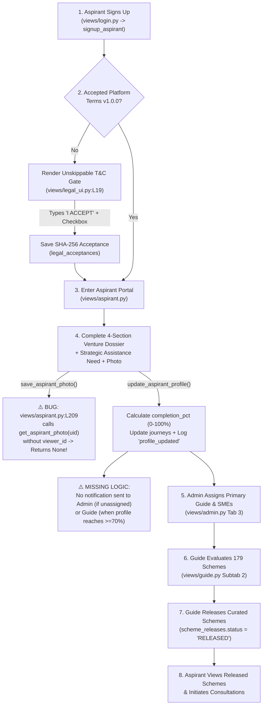
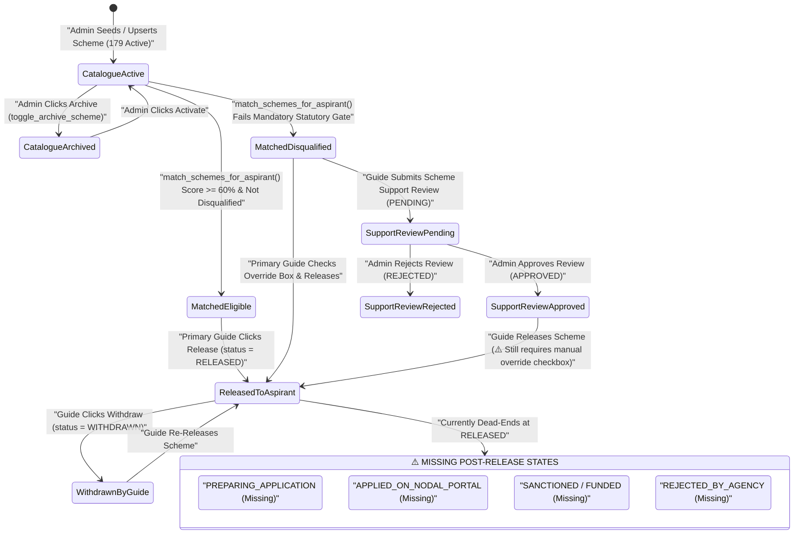
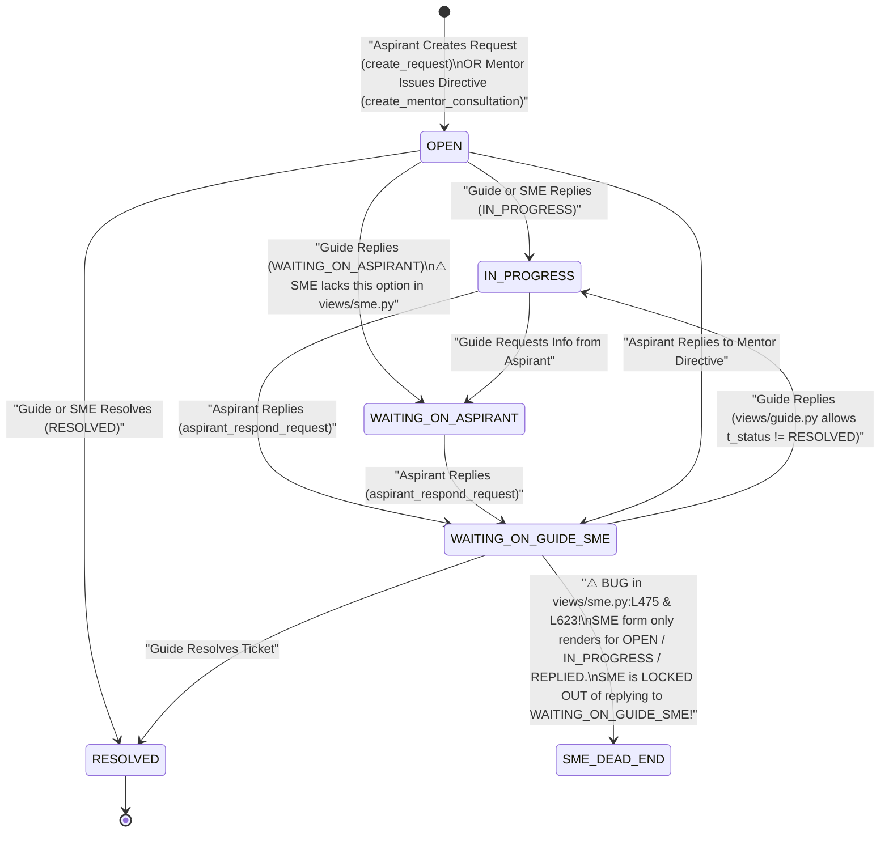
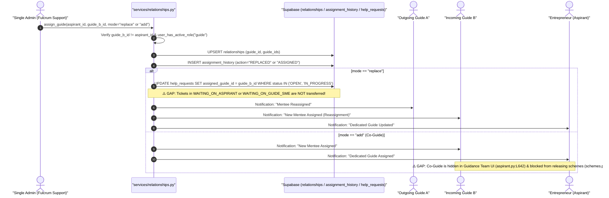
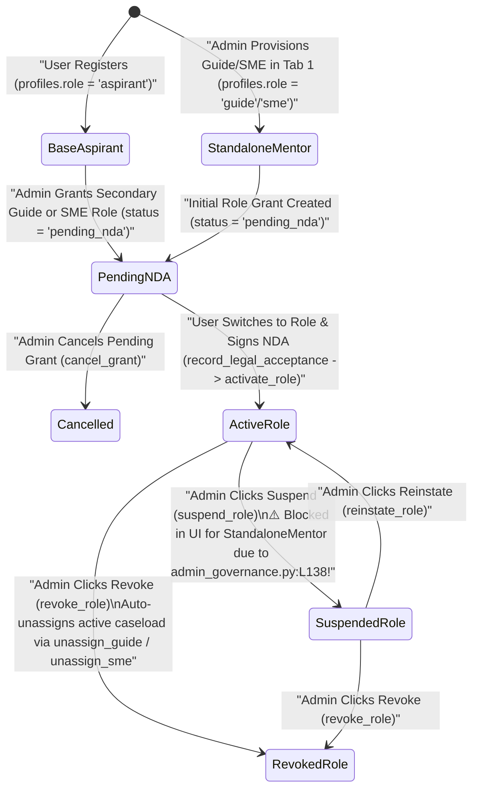
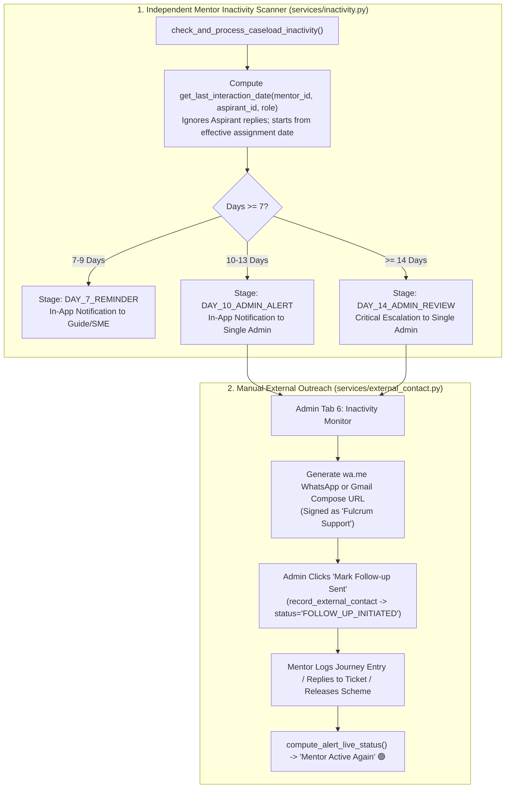

# FULCRUM-BETA → AGY ARGON: WORKFLOW & STATE-TRANSITION DIAGRAMS
**Deliverable 7 of 10 | Mode: Read-Only Architectural & State Modeling**

---

## 1. Workflow A: Aspirant Onboarding to First Value (`flowchart TD`)

---

## 2. Workflow B: Scheme Matching, Gatekeeper Review & Release State Machine (`stateDiagram-v2`)

---

## 3. Workflow C: Consultation & Ticket State Machine (`stateDiagram-v2`)

This diagram highlights the **critical dead-end bug** in [`views/sme.py:L475`](file:///c:/Users/hp/Desktop/Fulcrum-Alpha/fulcrum-cluster-b/views/sme.py#L475) and [`L623`](file:///c:/Users/hp/Desktop/Fulcrum-Alpha/fulcrum-cluster-b/views/sme.py#L623) when an Aspirant replies (`WAITING_ON_GUIDE_SME`):

---

## 4. Workflow D: Mentor Assignment, Co-Guides & Replacement Sequence (`sequenceDiagram`)

---

## 5. Workflow E: Multi-Role Grant, NDA Execution, Suspension & Revocation (`stateDiagram-v2`)

---

## 6. Workflow F: Two-Tier Escalation, Inactivity & External Contact (`flowchart TD`)

