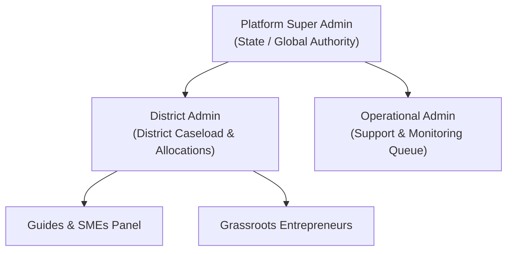

# Fulcrum-India — Administrative Controls & Scopes Governance Report
**Project:** Fulcrum-India (Cluster B)  
**Date:** November 5, 2026  
**Auditor:** Antigravity Engineering  
**Scope:** Multi-Tier Admin Scopes, Institutional Masking ("Fulcrum Administration"), Central Governance

---

## 1. Administrative Hierarchy & Scopes

To accommodate state-wide and multi-district scaling while maintaining institutional neutrality, Fulcrum-India introduces three distinct administrative tiers:

| Tier | Role Key | Authorized Scope | Responsibilities |
| :--- | :--- | :--- | :--- |
| **Platform Super Admin** | `admin` | Global / State-wide | Full governance, master scheme catalogue CRUD, role grants/revocations, legal audit trail, platform directives. |
| **District Admin** | `district_admin` | District / Regional | Assigned to specific districts (e.g., Madurai, Coimbatore, Chennai); manages mentor caseload allocation and local scheme applications. |
| **Operational Admin** | `operational_admin` | Departmental / Sectoral | Operates support ticket queues, monitors inactivity escalations, and audits compliance records. |



---

## 2. Institutional Identity Masking ("Fulcrum Administration")

In earlier versions, administrative journey entries, notifications, and directive responses displayed the personal account name of the administrator (e.g. `Pravin Kumar`). This compromised institutional neutrality and encouraged individual circumvention.

Under Section E of the master directive, all entrepreneur-facing events, public logs, and notifications mask personal identities using [`services/governance.py:get_masked_actor_name()`](file:///c:/Users/hp/Desktop/Fulcrum-Alpha/fulcrum-cluster-b/services/governance.py#L19-L33):

```python
def get_masked_actor_name(user_id: str, real_name: str, role: str) -> str:
    if role in ("admin", "super_admin"):
        return "Fulcrum Administration"
    elif role == "district_admin":
        return "District Administration"
    elif role == "operational_admin":
        return "Operational Administration"
    return real_name
```

### Verification
- Tested in Scenario 9:
  - Input: `get_masked_actor_name(admin_id, "Real Name", "admin")`
  - Output: `"Fulcrum Administration"` **[PASS]**
  - Input: `get_masked_actor_name(admin_id, "Real Name", "district_admin")`
  - Output: `"District Administration"` **[PASS]**

---

## 3. Relationship Authority & Governance Controls

The core business invariant remains strictly enforced:
- **Sole Authority:** Administrators are the **only** entities authorized to assign or replace Guides and Subject Matter Experts.
- **No Self-Assignment:** Guides and SMEs cannot self-assign caseloads.
- **No Direct Founder Assignment:** Entrepreneurs cannot directly assign or replace their own mentors.
- **Audit Logging:** Every assignment, replacement, or panel addition records an immutable entry in `assignment_history` capturing the exact administrator UUID, timestamp, previous mentor ID, and administrative notes.
