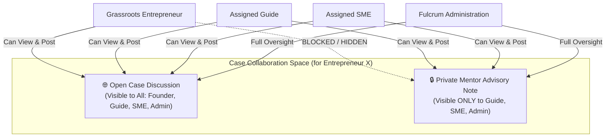

# Fulcrum-India — Unified Case Collaboration Space Report
**Project:** Fulcrum-India (Cluster B)  
**Date:** November 5, 2026  
**Auditor:** Antigravity Engineering  
**Scope:** Advisory Collaboration, Open Discussions, Private Mentor Notes, Role-Based Access Gating

---

## 1. Overview & Purpose

Guiding a grassroots venture from inception to institutional funding requires coordinated synergy between the entrepreneur, the dedicated enterprise Guide, and specialized Subject Matter Experts (e.g. Chartered Accountants for GST, Food Technologists for FSSAI, Patent Agents for IP).

Prior implementations maintained fragmented consultation threads. Fulcrum-India introduces the **Unified Case Collaboration Space** in [`services/collaboration.py`](file:///c:/Users/hp/Desktop/Fulcrum-Alpha/fulcrum-cluster-b/services/collaboration.py):
1. **Open Case Discussions:** Shared discussion threads visible to the entrepreneur, assigned Guide, assigned SME, and Administration.
2. **Private Mentor Advisory Notes:** A secure channel allowing Guides and SMEs to coordinate internal venture evaluations, flag creditworthiness risks, or discuss DPR gaps **strictly concealed from the entrepreneur**.
3. **Multi-Role Integration:** Accessible from the Aspirant portal, Guide workspace, and SME caseload desk.



---

## 2. Database Schema (`case_discussions`)

Defined in [`migrations/001_multi_role_and_legal.sql`](file:///c:/Users/hp/Desktop/Fulcrum-Alpha/fulcrum-cluster-b/migrations/001_multi_role_and_legal.sql#L96-L109):

```sql
CREATE TABLE IF NOT EXISTS public.case_discussions (
    id                     UUID PRIMARY KEY DEFAULT gen_random_uuid(),
    aspirant_id            UUID NOT NULL REFERENCES public.profiles(id) ON DELETE CASCADE,
    author_id              UUID NOT NULL REFERENCES public.profiles(id),
    author_role            TEXT NOT NULL,
    title                  TEXT NOT NULL,
    message                TEXT NOT NULL,
    attachments            JSONB DEFAULT '[]'::jsonb,
    is_private_mentor_note BOOLEAN DEFAULT FALSE,
    created_at             TIMESTAMPTZ DEFAULT NOW()
);
```

---

## 3. Server-Side Data Isolation

Data gating is enforced in [`services/collaboration.py:list_case_messages()`](file:///c:/Users/hp/Desktop/Fulcrum-Alpha/fulcrum-cluster-b/services/collaboration.py#L60-L108):

```python
def list_case_messages(aspirant_id: str, requesting_role: str = "aspirant") -> List[Dict]:
    # Gating: If requesting_role is 'aspirant', strictly filter out private notes
    if requesting_role == "aspirant":
        query = query.eq("is_private_mentor_note", False)
```

Furthermore, [`create_case_message()`](file:///c:/Users/hp/Desktop/Fulcrum-Alpha/fulcrum-cluster-b/services/collaboration.py#L19-L57) rejects any attempt by an Aspirant to post a private note:
```python
if is_private_mentor_note and author_role not in ("guide", "sme", "admin", "district_admin", "operational_admin"):
    return False, "Entrepreneurs cannot create private mentor notes."
```

---

## 4. UI Implementation across Portals

### 4.1 Aspirant Dashboard (`views/aspirant.py`)
- In **Tab 6 (🤝 Consult a Guide or SME)**:
  - Appended **"💬 Advisory Case Discussions & Collaboration"** expander.
  - Displays all open threads with mentor author badges.
  - Allows founders to post questions or status updates directly to their advisory panel.

### 4.2 Guide Caseload Desk (`views/guide.py`)
- In **Mentee Context Subtabs**:
  - Added dedicated navigation pill **"💬 Case Collaboration"**.
  - Displays both open threads (blue left border) and private notes (red left border with `🔒 PRIVATE MENTOR NOTE` badge).
  - Form includes checkbox: `[ ] Mark as Private Mentor Advisory Note`.

---

## 5. Verification Results
- **Scenario 13 Verified:** A Guide posted one open discussion message and one private advisory note. Queried as Aspirant: only the open message was returned. Queried as Guide: both messages were returned **[PASS]**.
