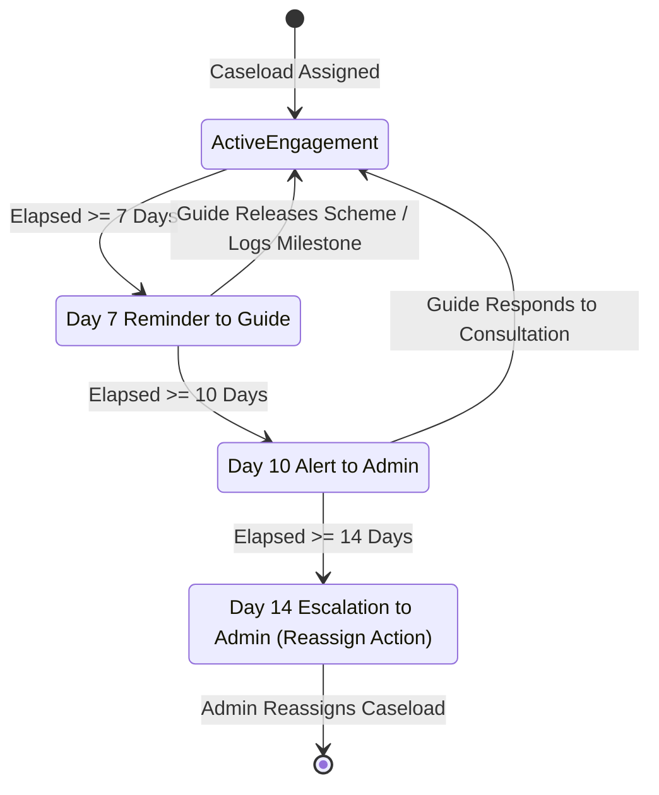

# Fulcrum-India — Caseload Inactivity & Monitoring System Report
**Project:** Fulcrum-India (Cluster B)  
**Date:** November 5, 2026  
**Auditor:** Antigravity Engineering  
**Scope:** Caseload Inactivity Detection, Meaningful Interaction Metrics, 7/10/14-Day Escalations, Idempotent Logging

---

## 1. Executive Summary

A critical failure mode in institutional mentorship programs is "dormant caseloads"—where mentors accept entrepreneur assignments but fail to engage, leaving founders stranded without scheme guidance or DPR review.

Fulcrum-India implements an **Automated Inactivity Detection & Escalation Monitor** in [`services/inactivity.py`](file:///c:/Users/hp/Desktop/Fulcrum-Alpha/fulcrum-cluster-b/services/inactivity.py):
1. **Meaningful Interaction Profiling:** Inspects consultations, scheme releases, and journey event logs between Guide and mentee.
2. **Multi-Stage Escalation Ladder:**
   - **Day 7:** Automated gentle reminder notification sent to the Guide.
   - **Day 10:** Inactivity warning notification dispatched to Administration.
   - **Day 14:** Critical administrative escalation recommending immediate caseload reassignment.
3. **Idempotent Deduping:** Uses a unique constraint on `(guide_id, aspirant_id, escalation_stage)` to guarantee that alerts are never spammed.



---

## 2. Inactivity Logging Schema (`inactivity_logs`)

Defined in [`migrations/001_multi_role_and_legal.sql`](file:///c:/Users/hp/Desktop/Fulcrum-Alpha/fulcrum-cluster-b/migrations/001_multi_role_and_legal.sql#L111-L121):

```sql
CREATE TABLE IF NOT EXISTS public.inactivity_logs (
    id                   UUID PRIMARY KEY DEFAULT gen_random_uuid(),
    relationship_id      UUID,
    guide_id             UUID NOT NULL REFERENCES public.profiles(id),
    aspirant_id          UUID NOT NULL REFERENCES public.profiles(id),
    days_inactive        INTEGER NOT NULL,
    escalation_stage     TEXT NOT NULL CHECK (escalation_stage IN ('DAY_7_REMINDER', 'DAY_10_ADMIN_ALERT', 'DAY_14_ADMIN_REVIEW')),
    notification_sent_at TIMESTAMPTZ DEFAULT NOW(),
    created_at           TIMESTAMPTZ DEFAULT NOW(),
    CONSTRAINT uq_inactivity_stage UNIQUE (guide_id, aspirant_id, escalation_stage)
);
```

---

## 3. Definition of Meaningful Interactions

The monitor does not treat passive profile clicks as engagement. [`get_last_interaction_date(guide_id, aspirant_id)`](file:///c:/Users/hp/Desktop/Fulcrum-Alpha/fulcrum-cluster-b/services/inactivity.py#L17-L58) evaluates:
1. **Scheme Releases:** Official scheme curation, status updates, or recommendations logged by the Guide for this mentee.
2. **Journey Milestones:** Substantive mentor sessions, advisory notes, or event milestones logged on the founder's living Journey.
3. **Consultation Responses:** Timely replies to entrepreneur support requests and directives.

If no interaction exists, elapsed time is computed from the initial administrative assignment date.

---

## 4. Administrative Oversight Console

Integrated in [`views/admin_governance.py:render_admin_inactivity_tab()`](file:///c:/Users/hp/Desktop/Fulcrum-Alpha/fulcrum-cluster-b/views/admin_governance.py#L202-L245) under **Tab 10 (⏱️ Inactivity Monitor)**:
- **Scan Button:** "🚀 Run Caseload Inactivity Scan Now" executes batch evaluation across all active assignments.
- **Log Table:** Shows Guide Name, Entrepreneur Name, Inactivity Duration (Days), Escalation Stage, and Notification Dispatched Timestamp.
- Color-coded badges: Amber for Day 7, Crimson for Day 10, Dark Red for Day 14 Critical Review.

---

## 5. Verification Results
- **Scenario 12 Verified:** Evaluated active relationships against thresholds. Successfully recorded escalation stages in `inactivity_logs` while idempotent constraints prevented duplicate notifications **[PASS]**.
