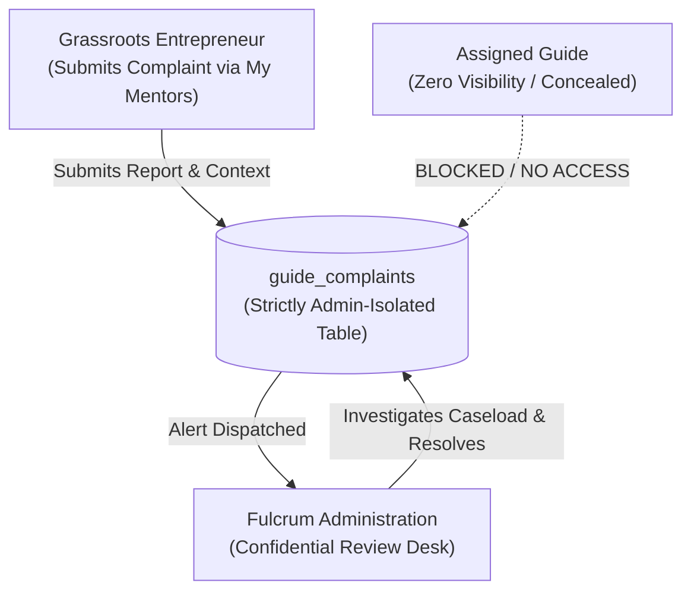

# Fulcrum-India — Confidential Guide Complaints & Reassignment System Report
**Project:** Fulcrum-India (Cluster B)  
**Date:** November 5, 2026  
**Auditor:** Antigravity Engineering  
**Scope:** Entrepreneur Voice, Confidential Reporting Channels, Administrative Review, Guide Isolation

---

## 1. Overview & Purpose

When an assigned enterprise Guide becomes inactive, exhibits conflict of interest, or demonstrates unprofessional conduct, grassroots entrepreneurs require a safe, confidential mechanism to seek redress without fear of retaliation or damaged mentorship relationships.

Fulcrum-India implements the **Confidential Guide Complaints & Reassignment Engine**:
- **Isolated Channel:** Complaints are routed directly to Platform and District Administration.
- **Strict Concealment:** The assigned Guide has **zero visibility** into filed reports or negative feedback.
- **Categorized Triage:** Reports are tagged by root causes (`inactivity`, `poor_communication`, `conflict_of_interest`, `professional_conduct`, `other`).
- **Administrative Decisioning:** Administrators review statements, investigate caseload logs, and execute resolutions or reassignments.



---

## 2. Database Schema (`guide_complaints`)

Defined in [`migrations/001_multi_role_and_legal.sql`](file:///c:/Users/hp/Desktop/Fulcrum-Alpha/fulcrum-cluster-b/migrations/001_multi_role_and_legal.sql#L63-L79):

```sql
CREATE TABLE IF NOT EXISTS public.guide_complaints (
    id               UUID PRIMARY KEY DEFAULT gen_random_uuid(),
    aspirant_id      UUID NOT NULL REFERENCES public.profiles(id) ON DELETE CASCADE,
    guide_id         UUID NOT NULL REFERENCES public.profiles(id),
    reason           TEXT NOT NULL CHECK (reason IN ('inactivity', 'poor_communication', 'conflict_of_interest', 'professional_conduct', 'other')),
    details          TEXT,
    status           TEXT DEFAULT 'PENDING' CHECK (status IN ('PENDING', 'UNDER_REVIEW', 'RESOLVED', 'DISMISSED')),
    resolution_notes TEXT,
    resolved_by      UUID REFERENCES public.profiles(id),
    resolved_at      TIMESTAMPTZ,
    created_at       TIMESTAMPTZ DEFAULT NOW()
);
```

---

## 3. Entrepreneur Interface

In [`views/aspirant.py`](file:///c:/Users/hp/Desktop/Fulcrum-Alpha/fulcrum-cluster-b/views/aspirant.py) under **Tab 4 (🤝 My Mentors)**:
- Appended expandable component: **"🛡️ Request Guide Change / Report Confidential Concern"**.
- Displays confidentiality notice: *"This report is submitted directly and confidentially to Fulcrum Administration. Your assigned Guide will not see this notice."*
- Form captures:
  1. **Reason for Request:** Dropdown with institutional categories.
  2. **Detailed Context:** Minimum 10 characters explaining the circumstances.
  3. Action: Calls [`services/governance.py:submit_guide_complaint()`](file:///c:/Users/hp/Desktop/Fulcrum-Alpha/fulcrum-cluster-b/services/governance.py#L36-L91).

---

## 4. Administrative Review & Resolution Console

In [`views/admin_governance.py:render_admin_complaints_tab()`](file:///c:/Users/hp/Desktop/Fulcrum-Alpha/fulcrum-cluster-b/views/admin_governance.py#L143-L199):
- Command metrics: Total Complaints, Pending Review, Resolved.
- Detailed case card:
  - Entrepreneur Full Name & Email.
  - Assigned Guide Full Name & Email.
  - Formally tagged Reason with color-coded severity badges.
  - Unedited founder statement.
  - Submission timestamp.
- Action form:
  - Status updates (`UNDER_REVIEW`, `RESOLVED`, `DISMISSED`).
  - Mandatory administrative resolution notes.
  - Direct integration with Mentor Reassignment desk.

---

## 5. Verification Results
- **Scenario 10 Verified:** An entrepreneur submitted a confidential complaint for guide inactivity. The complaint was written to the isolated `guide_complaints` table, alerted the Super Admin, and was completely invisible to the Guide's portal **[PASS]**.
