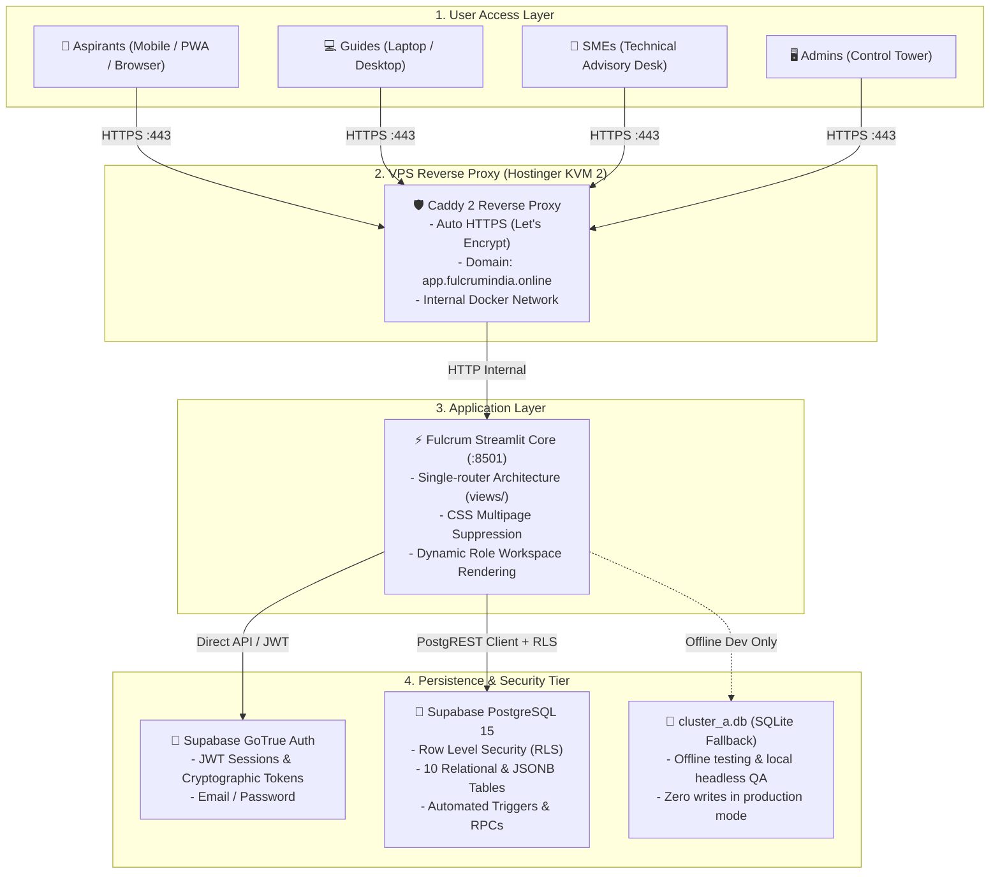

# FULCRUM-INDIA: System Architecture, Domain Nuances & Database Backup Report

**Workspace:** `c:\Users\hp\Desktop\Fulcrum-Alpha\fulcrum-cluster-b`  
**Application Portal:** `https://app.fulcrumindia.online`  
**Production Server:** Hostinger KVM 2 VPS (`187.126.114.81`)  
**Active Production Backend:** Supabase Managed Cloud (`https://wpiyyhrmxnorfjfzqlqf.supabase.co`)  
**Audit & Backup Timestamp:** 2026-11-04T22:57:21+05:30  

---

## 1. Executive Summary & Purpose

**FULCRUM-INDIA** is an enterprise guidance and venture capital gatekeeping operating system built to navigate grassroots entrepreneurs across India (starting with Tamil Nadu) through every phase of building and scaling a company.

The platform coordinates a **tripartite human network**:
1. **Aspirants (Entrepreneurs):** Record their venture milestones on a unified chronological spine, complete a 4-part venture profile, and discover curated funding opportunities.
2. **Guides (Institutional Mentors):** Oversee holistic venture progress, evaluate private insider intelligence and red flags, and act as gatekeepers who release vetted government and private funding schemes to founders.
3. **SMEs (Domain Specialists):** Subject matter experts (GST, legal, patent/IP, FSSAI food safety, pollution control) who provide targeted technical consultations.
4. **Administrators (Program Directorate / Control Tower):** Exercise exclusive authority over mentor-mentee allocations, manage the 170+ scheme catalogue, govern SLAs, inspect the global journey timeline, and generate investor-grade PDF dossiers.

---

## 2. System Architecture & Evolutionary Roadmap



### The Transition from V1 Prototype to PRD V2
* **Current Deployed Core (Cluster A / Cluster B):** A Streamlit application backed directly by Supabase PostgreSQL and GoTrue Auth. It eliminates enterprise bloat (zero Redis, zero Celery, zero Kafka) by implementing synchronous, deterministic execution and database-driven event logging.
* **PRD V2 Blueprint (Documented in `PRD.md`):** Outlines the next-generation decoupled evolution:
  - **Frontend:** Next.js 15 (React + Tailwind + shadcn/ui) for instant mobile performance, deep URLs (`/journey`, `/schemes/:id`), and PWA capabilities.
  - **Heavy Compute Worker:** Python FastAPI microservice dedicated to headless Chromium (Playwright) PDF dossier rendering and AI DPR report generation.
  - **Database & Realtime:** Supabase managed cloud remains the continuous single source of truth across both generations.

---

## 3. The Four Core Roles & Governance Boundaries

| Role | Provisioning | Permissions & Boundaries |
| :--- | :--- | :--- |
| **Aspirant** | **Public Self-Signup** | Can complete 4-part profile, view assigned Guide & SME, log own Journey entries, view released scheme matches, and raise Help requests. Cannot self-assign mentors or view unreleased scheme intelligence. |
| **Guide** | **Admin Provisioning Only** (No public signup) | Dedicated mentor portal. Can inspect complete Journey of assigned Aspirants, log mentorship milestones (business model, pricing, strategy), evaluate insider intelligence/red flags, and release/withdraw schemes. |
| **SME** | **Admin Provisioning Only** (No public signup) | Specialized technical advisory. Can view assigned Aspirants for specific domains (GST, legal, patents, food safety), contribute technical guidance to the journey spine, and submit directives to Admin. |
| **Admin** | **Database-Driven** (`profiles.role='admin'`) | Command metrics, create Guide & SME accounts, **exclusive assignment authority** for mentors, global journey inspection with soft-delete oversight, scheme catalogue CRUD, help queue resolution. |

> [!IMPORTANT]
> **The Strict Relationship Invariant**: Aspirants and Mentors (Guides/SMEs) cannot self-assign or pair with each other. The Admin is the sole authority for assigning Guides and SMEs to Aspirants (`relationships.assigned_by = admin_id`).

---

## 4. Key Domain Concepts & Operational Nuances

### 1. The Journey Spine ("The Movie / Post-Credits" Model)
* The core data structure is an append-only chronological timeline (`journey_events`) linked to the entrepreneur's `journey_id`.
* Every event has an explicit `actor_role`:
  - `[ASPIRANT]` (Green) — Self-reported business milestones, sales achievements, license applications.
  - `[GUIDE]` (Emerald) — Strategic mentorship sessions, pricing models, market positioning.
  - `[SME]` (Sky Blue) — Technical compliance checklists, tax structuring, patent filings.
  - `[ADMIN]` (Pink) — Mentor allocations, status escalations, dossier releases.
  - `[SYSTEM]` (Indigo) — Profile completion triggers, automated matching alerts.
* **Roadmap Autonomy (`included_in_roadmap`)**: Aspirants can toggle whether an event appears on their public investor roadmap without deleting the underlying audit log.
* **Soft Deletion (`deleted_at`, `deleted_by`)**: Entries are never hard-deleted from PostgreSQL/SQLite; they are flagged to maintain historical integrity.

### 2. Scheme Intelligence & Deterministic Matching Engine
* **Source & Size**: Exactly 170+ validated central and Tamil Nadu state schemes extracted from `FOUNDER_AI_DIGITAL_PLAYBOOK_2026.html`.
* **Scoring Dimensions (0–100%)**:
  1. Sector / Industry Fit (Up to 40 pts, with negative penalties for incompatible high-tech/pharma verticals).
  2. Enterprise Stage Alignment (Up to 25 pts: Idea, Pre-Seed, Early-Stage, Growth).
  3. State / Jurisdiction (Up to 20 pts: Central vs. Tamil Nadu state schemes).
  4. Demographic Quotas & Inclusivity (Up to 15 pts: Women founders, SC/ST, OBC, Rural, StartupTN registered).
* **Explainable Matching**: Every match generates a transparent checklist of *"Why This Matched"* (e.g. `✓ Located in Tamil Nadu`, `✓ Food Processing sector match`, `✓ Seed stage match`).
* **Ethical Terminology Invariant**: Strictly labeled **Recommended** or **Potentially Eligible** — code strictly forbids terms like "Approved", "Guaranteed", or "Sanctioned".

### 3. The Scheme Gatekeeper Model
* Aspirants do **not** receive open, unvetted access to government grants.
* Instead, schemes scoring $\ge 60\%$ appear in the **Guide Workspace**.
* The Guide reviews **Private Insider Intelligence** (e.g. realistic disbursement delays, bank branch quotas) and **Private Red Flags** (e.g. collateral traps) that are concealed from the founder.
* A scheme is only unlocked in the Aspirant's portal when the Guide formally clicks **"Release Scheme"** and enters mandatory recommendation notes.

### 4. Dual-Backend Mechanics: Supabase vs. SQLite
* **Production Configuration (`DATA_BACKEND=supabase`)**:
  - Validated at startup via `validate_production_configuration()`.
  - In Supabase mode, `cluster_a.db` is strictly frozen and read-only. No SQLite healing, mutation, or write operations take place.
  - Row Level Security (RLS) is enforced on all client requests using authenticated JWTs.
* **Offline / Local Dev Fallback (`DATA_BACKEND=sqlite`)**:
  - `cluster_a.db` acts as a resilient offline store with an identical 10-table schema.
  - Contains 152 seeded/test profiles, 29 relationships, 33 journeys, and 230 journey events used during offline QA and automated test matrices.

---

## 5. Database Backup Summary

A unified, disaster-recovery backup archive has been generated and validated:

**Primary Archive File:**  
`c:\Users\hp\Desktop\Fulcrum-Alpha\fulcrum-cluster-b\backups\fulcrum_database_backup_2026-11-04_22-57-21.zip` (481.5 KB)

**Standalone Supabase Cloud Backup:**  
`c:\Users\hp\Desktop\Fulcrum-Alpha\fulcrum-cluster-b\backups\supabase_backup_2026-11-04_22-55-16.zip` (123.5 KB)

### Backup Table Verification & Comparison

| Table Name | Supabase Cloud (Live Production) | SQLite Local (`cluster_a.db`) | Export Formats in Backup |
| :--- | :---: | :---: | :--- |
| `profiles` | 5 | 152 | JSON + CSV |
| `relationships` | 1 | 29 | JSON + CSV |
| `journeys` | 1 | 33 | JSON + CSV |
| `journey_events` | 13 | 230 | JSON + CSV |
| `help_requests` | 0 | 55 | JSON + CSV |
| `notifications` | 4 | 139 | JSON + CSV |
| `assignment_history` | 2 | 36 | JSON + CSV |
| `schemes` | 179 | 170 | JSON + CSV |
| `scheme_releases` | 0 | 4 | JSON + CSV |
| `activity_log` | 0 | 27 | JSON + CSV |
| **Auth Users (`auth_users.json`)** | **5 Accounts** | *N/A (Built-in hashes)* | JSON (`id`, `email`, metadata) |
| **Raw Database Binary** | *Cloud Managed* | **`cluster_a.db` (1.03 MB)** | SQLite Binary |
| **SQL DDL & DML Dump** | `supabase_setup.sql` | **`cluster_a_dump.sql`** | Full SQL Text |

### Registered Supabase Auth Accounts Backed Up
1. `fulcrumindia1@gmail.com` — **Admin** (`Fulcrum Administrator`)
2. `pravindev666@gmail.com` — **Aspirant** (`Pravin A Mathew`)
3. `vanisrisjvl@gmail.com` — **Guide** (`Vanisri`)
4. `manicksjvl@gmail.com` — **SME** (`Manick Rajendran`)
5. `manickfulcrum@gmail.com` — **Guide** (`Manick Rajendran`)

### How to Restore

```bash
# 1. Restore into Supabase Managed Cloud:
python scripts/supabase_backup_manager.py restore backups/supabase_backup_2026-11-04_22-55-16.zip

# 2. Emergency Restore into Local SQLite:
python scripts/supabase_backup_manager.py restore-sqlite backups/supabase_backup_2026-11-04_22-55-16.zip

# 3. Direct SQLite Restoration from Unified Backup:
# Simply extract sqlite_local/cluster_a.db from fulcrum_database_backup_2026-11-04_22-57-21.zip
# into the project root directory.
```
