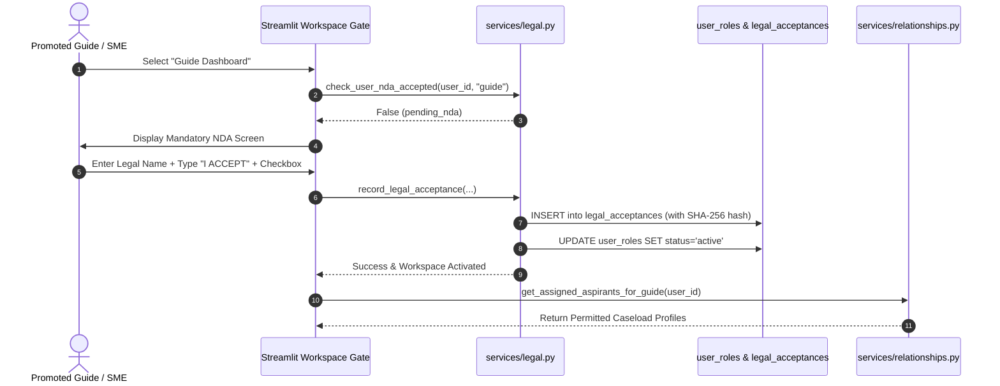

# Fulcrum-India — Legal & NDA Governance System Report
**Project:** Fulcrum-India (Cluster B)  
**Date:** November 5, 2026  
**Auditor:** Antigravity Engineering  
**Scope:** Version-Controlled Agreements, Terms & Conditions Gate, Mandatory NDA, Cryptographic Signatures, Server-Side Access Gating

---

## 1. Executive Summary

Grassroots entrepreneurs share highly sensitive proprietary assets on Fulcrum-India, including trade secrets, business models, financial projections, GST filings, and patent applications. To protect entrepreneurs and maintain institutional compliance with the Indian Contract Act (1872) and Information Technology Act (2000), Fulcrum-India enforces a **cryptographic, versioned legal governance system**.

The system mandates:
1. **Platform Terms & Conditions:** Mandatory for all users before accessing any dashboard.
2. **Confidentiality & Non-Disclosure Agreement (NDA):** Mandatory for certified Guides and Subject Matter Experts (SMEs) prior to viewing assigned entrepreneur dossiers.
3. **Server-Side Caseload Gating:** Enforced at the service and API layers so that an unexecuted NDA cannot be bypassed via UI manipulation.
4. **Immutable Signature Records:** Tamper-evident acceptance records capturing SHA-256 document text hashes, typed full legal names, typed phrases (`"I ACCEPT"`), timestamps, and IP snapshots.



---

## 2. Database Schema

### 2.1 Legal Documents (`legal_documents`)
Version-controlled master text for all institutional agreements:

```sql
CREATE TABLE IF NOT EXISTS public.legal_documents (
    id             TEXT PRIMARY KEY,
    doc_type       TEXT NOT NULL CHECK (doc_type IN ('terms_and_conditions', 'nda_guide', 'nda_sme', 'nda_dual')),
    version        TEXT NOT NULL,
    title          TEXT NOT NULL,
    content        TEXT NOT NULL,
    content_hash   TEXT NOT NULL,
    roles_covered  JSONB DEFAULT '[]'::jsonb,
    effective_date DATE DEFAULT CURRENT_DATE,
    is_mandatory   BOOLEAN DEFAULT TRUE,
    is_active      BOOLEAN DEFAULT TRUE,
    created_at     TIMESTAMPTZ DEFAULT NOW()
);
```

### 2.2 Legal Acceptances (`legal_acceptances`)
Immutable audit trail capturing user signature transactions:

```sql
CREATE TABLE IF NOT EXISTS public.legal_acceptances (
    id                      UUID PRIMARY KEY DEFAULT gen_random_uuid(),
    user_id                 UUID NOT NULL REFERENCES public.profiles(id) ON DELETE CASCADE,
    document_id             TEXT NOT NULL,
    doc_type                TEXT NOT NULL,
    doc_version             TEXT NOT NULL,
    doc_hash                TEXT NOT NULL,
    user_email_snapshot     TEXT NOT NULL,
    typed_legal_name        TEXT NOT NULL,
    typed_acceptance_phrase TEXT NOT NULL,
    checkbox_confirmed      BOOLEAN DEFAULT TRUE,
    roles_covered           JSONB DEFAULT '[]'::jsonb,
    ip_address              TEXT,
    user_agent              TEXT,
    status                  TEXT DEFAULT 'ACCEPTED',
    accepted_at             TIMESTAMPTZ DEFAULT NOW()
);
```

---

## 3. Mandatory Signing Requirements Enforced

To prevent inadvertent or fraudulent clicks, [`record_legal_acceptance()`](file:///c:/Users/hp/Desktop/Fulcrum-Alpha/fulcrum-cluster-b/services/legal.py#L137-L224) strictly validates:
1. **Full Legal Name:** User must confirm their complete name matching official records (`len >= 3`).
2. **Explicit Typed Phrase:** User must explicitly type `"I ACCEPT"` in capital letters (case-insensitive validation).
3. **Explicit Checkbox:** Affirmative consent checkbox must be checked.
4. **Cryptographic Immutability:** SHA-256 hash of the document content is computed and permanently stored alongside the signature. If document terms are amended in the future, old acceptances will not match the new hash, triggering an automated re-consent requirement.

---

## 4. Server-Side Caseload Access Gating

UI-level hiding is insufficient for enterprise data security. Strict server-side gates are embedded in:
- [`services/relationships.py:get_assigned_aspirants_for_guide()`](file:///c:/Users/hp/Desktop/Fulcrum-Alpha/fulcrum-cluster-b/services/relationships.py#L561-L570)
- [`services/relationships.py:get_assigned_aspirants_for_sme()`](file:///c:/Users/hp/Desktop/Fulcrum-Alpha/fulcrum-cluster-b/services/relationships.py#L617-L626)

```python
# Strict Server-Side NDA Authorization Gate
from services.legal import check_user_nda_accepted
if not check_user_nda_accepted(mentor_id, role):
    # NDA pending! Block return of entrepreneur profiles & dossiers
    return []
```

If a user bypasses the UI and calls the data service directly while their status is `pending_nda`, an empty list is returned, ensuring 100% data confidentiality.

---

## 5. Administrative Oversight Console

In [`views/admin_governance.py:render_admin_legal_records_tab()`](file:///c:/Users/hp/Desktop/Fulcrum-Alpha/fulcrum-cluster-b/views/admin_governance.py#L102-L140), platform administrators can inspect:
- Total signed agreements recorded.
- Filter by agreement type (`terms_and_conditions`, `nda_dual`, `nda_guide`, `nda_sme`).
- Full audit cards displaying: Full Legal Name, User Email, Document Type & Version, Truncated Cryptographic Hash (`b8c9d2e1f4a5...`), Typed Signature Phrase (`"I ACCEPT"`), Acceptance Timestamp, and IP Snapshot.
- Legal status badge: `BINDING & VERIFIED`.
