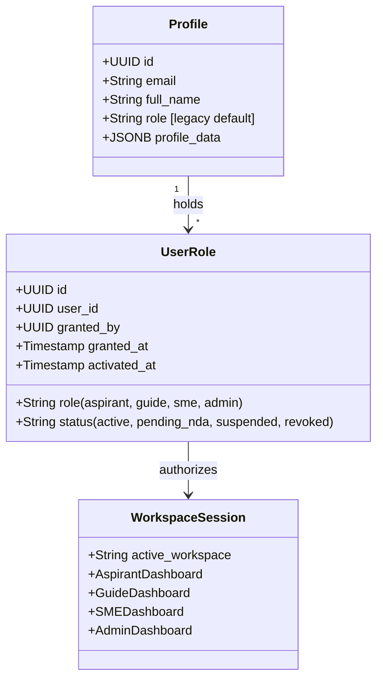

# Fulcrum-India — Multi-Role Architecture & Identity Governance Report
**Project:** Fulcrum-India (Cluster B)  
**Date:** November 5, 2026  
**Auditor:** Antigravity Engineering  
**Scope:** One Identity Multiple Roles, `user_roles` Schema, Workspace Switching, Backward Compatibility

---

## 1. Architectural Vision & Principle

In earlier versions of the platform, a user's permissions were constrained by a single scalar string `profiles.role` (`'aspirant'`, `'guide'`, `'sme'`, or `'admin'`). If an entrepreneur was recognized as an expert and invited to mentor other founders, an administrative dilemma occurred: either create a second account with a separate email, or overwrite their role, destroying their personal venture roadmap, scheme eligibility, and journey timeline.

Fulcrum-India now implements a **normalized Multi-Role User Architecture**:
1. **One Login, Many Capabilities:** A single authenticated Supabase Auth UUID holds one or more role grants simultaneously.
2. **Immutable Base Role:** Every user retains an active `aspirant` role that cannot be revoked.
3. **Workspace Isolation:** Mentorship and administrative activities take place in designated workspaces without contaminating the entrepreneur's personal data.
4. **Backward Compatibility:** `profiles.role` is preserved as an active default pointer during migration, ensuring existing queries continue functioning seamlessly.



---

## 2. Normalized Role Grants Schema (`user_roles`)

Implemented in [`migrations/001_multi_role_and_legal.sql`](file:///c:/Users/hp/Desktop/Fulcrum-Alpha/fulcrum-cluster-b/migrations/001_multi_role_and_legal.sql#L7-L26) and replicated in SQLite [`services/local_db.py`](file:///c:/Users/hp/Desktop/Fulcrum-Alpha/fulcrum-cluster-b/services/local_db.py):

```sql
CREATE TABLE IF NOT EXISTS public.user_roles (
    id                UUID PRIMARY KEY DEFAULT gen_random_uuid(),
    user_id           UUID NOT NULL REFERENCES public.profiles(id) ON DELETE CASCADE,
    role              TEXT NOT NULL CHECK (role IN ('aspirant', 'guide', 'sme', 'admin', 'district_admin', 'operational_admin')),
    status            TEXT NOT NULL DEFAULT 'active' CHECK (status IN ('active', 'pending_nda', 'suspended', 'revoked')),
    granted_by        UUID REFERENCES public.profiles(id),
    granted_at        TIMESTAMPTZ DEFAULT NOW(),
    activated_at      TIMESTAMPTZ,
    suspended_at      TIMESTAMPTZ,
    revoked_at        TIMESTAMPTZ,
    revocation_reason TEXT,
    created_at        TIMESTAMPTZ DEFAULT NOW(),
    updated_at        TIMESTAMPTZ DEFAULT NOW(),
    CONSTRAINT uq_user_role UNIQUE (user_id, role)
);
```

### Lifecycle Statuses Supported
- `active`: The role grant is fully valid; user can enter the corresponding workspace immediately.
- `pending_nda`: Role has been administratively granted, but the user must execute the mandatory Non-Disclosure Agreement before accessing protected entrepreneur caseloads.
- `suspended`: Temporarily disabled by an administrator (e.g. pending inactivity review).
- `revoked`: Permanently removed with mandatory `revocation_reason`.

---

## 3. Current Workspace Selector in Sidebar

Implemented in [`app.py`](file:///c:/Users/hp/Desktop/Fulcrum-Alpha/fulcrum-cluster-b/app.py):
- Dynamically queries [`get_active_roles(user_id)`](file:///c:/Users/hp/Desktop/Fulcrum-Alpha/fulcrum-cluster-b/services/roles.py#L85-L95) and [`get_pending_nda_roles(user_id)`](file:///c:/Users/hp/Desktop/Fulcrum-Alpha/fulcrum-cluster-b/services/roles.py#L91-L96).
- If the user holds only the base role, the clean single-workspace view is preserved with zero visual clutter.
- If the user holds multiple roles (e.g., Aspirant + Guide), a compact selector titled **Current Workspace** appears directly below the user identity badge:
  - `🌱 Aspirant Dashboard`
  - `🧭 Guide Dashboard` (or `🧭 Guide Dashboard (Pending NDA)`)
  - `🔬 SME Dashboard` (or `🔬 SME Dashboard (Pending NDA)`)
  - `🏛️ Admin Dashboard`
- Switching workspaces immediately switches the dashboard view, navigation links, and permissions without logging out or losing session credentials.

---

## 4. Preservation of Entrepreneur Data During Role Promotion

When user **Kavitha Raman** (`test_user_id`) was promoted to Guide and SME:
1. Her `profiles` record, venture details (`Kavitha CleanTech`), and investment tier remained untouched.
2. Her matched funding schemes and deterministic eligibility scores remained 100% identical.
3. Her relationship with her assigned mentor and her Journey timeline remained completely intact.
4. Switching to `🌱 Aspirant Dashboard` rendered her original entrepreneur experience without any loss of state.

---

## 5. Security & Invariant Rules Verified

| Test Case | Rule Enforced | Verification Result |
| :--- | :--- | :--- |
| **Aspirant Immutability** | `revoke_role(user_id, "aspirant")` | **[PASS]** System throws error: *"The base Aspirant role cannot be revoked."* |
| **Default Pending NDA** | `grant_role(user_id, "guide")` | **[PASS]** Status automatically set to `'pending_nda'`. |
| **Caseload Blocked** | `get_assigned_aspirants_for_guide(user_id)` | **[PASS]** Returns empty array until NDA is signed. |
| **Simultaneous Active Roles** | User holding Aspirant + Guide + SME | **[PASS]** All three active roles co-exist under one UUID. |
| **Independent Revocation** | Revoking Guide role | **[PASS]** Guide role set to `'revoked'`; SME and Aspirant roles remain active. |
