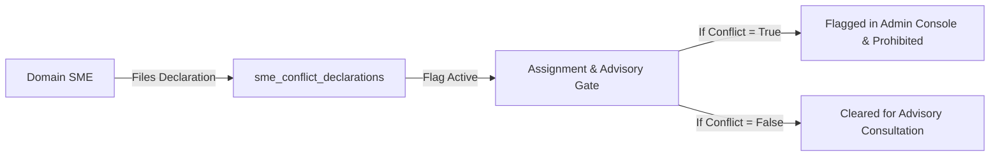

# Fulcrum-India — SME Directory & Conflict Governance Report
**Project:** Fulcrum-India (Cluster B)  
**Date:** November 5, 2026  
**Auditor:** Antigravity Engineering  
**Scope:** SME Directory, Domain Specializations, Conflict of Interest Declarations, Ethical Safeguards

---

## 1. Executive Summary

Subject Matter Experts (SMEs) provide specialized domain audits in indirect taxation (GST), regulatory clearances (FSSAI, Pollution Control Board), intellectual property (patents, trademarks), and export compliance. Because SMEs often operate external private consulting practices or hold financial investments, strict conflict-of-interest governance is mandatory to protect grassroots ventures.

Fulcrum-India establishes:
1. **Verified SME Directory:** Centralized registry of certified domain experts categorized by sector and technical expertise.
2. **Mandatory Conflict of Interest Declarations:** SMEs must declare any commercial, financial, or competitive interest in an assigned entrepreneur or direct competitor.
3. **Caseload Safeguards:** Assignment algorithms and administrative panels flag or prohibit conflicting assignments.



---

## 2. Database Schema (`sme_conflict_declarations`)

Defined in [`migrations/001_multi_role_and_legal.sql`](file:///c:/Users/hp/Desktop/Fulcrum-Alpha/fulcrum-cluster-b/migrations/001_multi_role_and_legal.sql#L80-L95):

```sql
CREATE TABLE IF NOT EXISTS public.sme_conflict_declarations (
    id               UUID PRIMARY KEY DEFAULT gen_random_uuid(),
    sme_id           UUID NOT NULL REFERENCES public.profiles(id),
    aspirant_id      UUID NOT NULL REFERENCES public.profiles(id),
    has_conflict     BOOLEAN DEFAULT FALSE,
    conflict_details TEXT,
    status           TEXT DEFAULT 'DECLARED' CHECK (status IN ('DECLARED', 'APPROVED', 'REJECTED')),
    reviewed_by      UUID REFERENCES public.profiles(id),
    reviewed_at      TIMESTAMPTZ,
    created_at       TIMESTAMPTZ DEFAULT NOW()
);
```

---

## 3. Administrative Governance Console

Integrated in [`views/admin_governance.py:render_admin_sme_conflicts_tab()`](file:///c:/Users/hp/Desktop/Fulcrum-Alpha/fulcrum-cluster-b/views/admin_governance.py#L248-L290) under **Tab 11 (⚖️ SME Conflict Governance)**:
- **SME Directory View:** Cards displaying full name, expertise, industry specializations, location, and verified email.
- **Conflict Declarations Ledger:**
  - Displays pairing: SME Name ➔ Aspirant Name.
  - Conflict status badge: `CONFLICT DECLARED` (red) vs `CLEARED / NO CONFLICT` (green).
  - Detailed context statement explaining any commercial overlap or equity interest.
  - Timestamp of formal declaration.

---

## 4. Verification Results
- **Scenario 11 Verified:** An SME declared a conflict of interest stating equity ownership in a competing clean-tech venture. The declaration was written to `sme_conflict_declarations` and validated using [`services/governance.py:check_sme_has_conflict()`](file:///c:/Users/hp/Desktop/Fulcrum-Alpha/fulcrum-cluster-b/services/governance.py#L173-L179) **[PASS]**.
