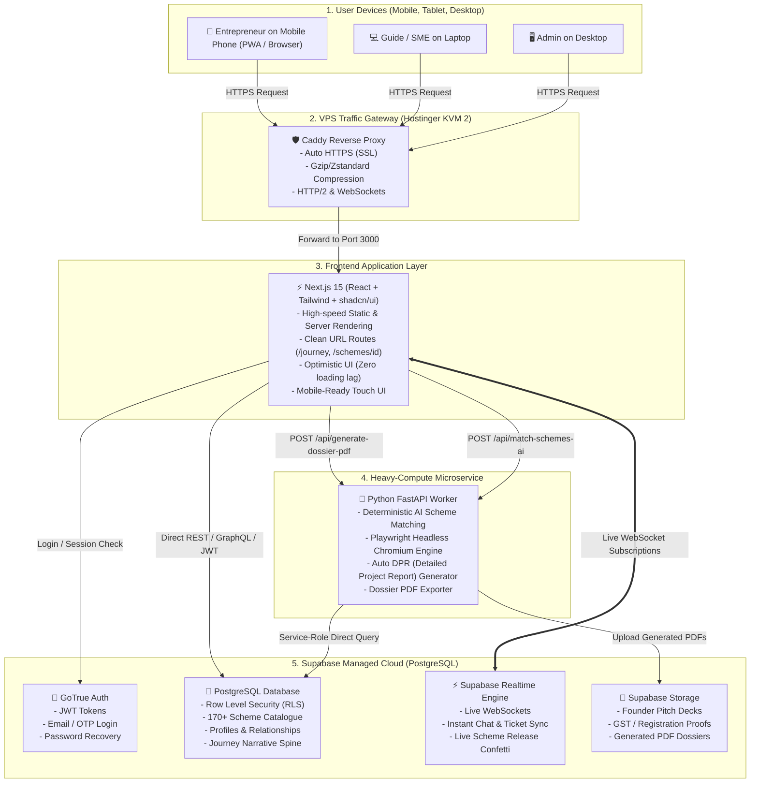

# FULCRUM 2.0: Product Requirements Document (PRD) & System Architecture Specification

**Product Name:** FULCRUM-INDIA (V2 Next-Gen Platform)  
**Document Version:** 2.0.0-DRAFT  
**Target Environment:** Hostinger KVM 2 VPS (Docker + Caddy) + Supabase Cloud (PostgreSQL + Auth + Realtime)  
**Status:** Architecture Blueprint & Roadmap  

---

## 1. Executive Vision & Problem Statement

### 1.1 The Mission
FULCRUM is an enterprise guidance and venture capital gatekeeping operating system designed to guide grassroots entrepreneurs across India (starting with Tamil Nadu) through every step of their entrepreneurial journey. It coordinates the tripartite human network helping them:
- **Aspirants (Entrepreneurs):** Record their living venture story (Journey Spine) and discover curated funding opportunities.
- **Guides (Institutional Mentors):** Oversee holistic venture progress, evaluate insider intelligence & red flags, and release vetted government/private funding schemes.
- **SMEs (Domain Specialists):** Provide technical, compliance, taxation, and legal guidance.
- **Administrators (Control Tower):** Allocate mentors, govern SLAs, and generate institutional reporting.

### 1.2 Why Evolve from V1 (Streamlit SPA) to V2 (Decoupled Full-Stack)?
While the V1 Streamlit prototype successfully proved the business logic and database models, Streamlit has fundamental architectural boundaries:
- **Server Memory Bottleneck:** Every user session maintains an open WebSocket inside the server's Python process (consuming 20–30 MB RAM per active tab).
- **No True URLs:** The browser address bar stays static (`app.fulcrumindia.online`), preventing direct link sharing or deep-linking to specific schemes or tickets.
- **No Native Smartphone Experience:** Screen-locks on mobile devices drop the WebSocket connection, causing page reload flickers.
- **No Native Push Notifications:** Mentors and entrepreneurs must open the site to check for updates rather than receiving alerts on their phones.

**Fulcrum 2.0 evolves into a modern, decoupled web & mobile platform capable of scaling to 50,000+ registered users and 5,000+ concurrent visitors on the exact same $10/month Hostinger VPS.**

---

## 2. The Master System Architecture ("How It All Connects")



---

## 3. The Tool Roster: Why Each Tool Exists & Why We Can't Use Just One

A common question is: *"Why do we need Next.js, FastAPI, PostgreSQL, and Realtime instead of just one tool?"*

In software engineering, forcing one tool to do everything is like having a food truck chef take orders, cook steaks, design flyers, and deliver food all at once. By assigning specialized tools to specialized tasks, the platform becomes **unbreakable and blazing fast**:

| Component | Technology | Exact Responsibility | Why We Use It (The Superpower) | Why Another Tool Can't Replace It |
| :--- | :--- | :--- | :--- | :--- |
| **Frontend** | **Next.js 15 (React)** | Renders the buttons, tabs, forms, and cards on the user's screen. | **Stateless & Ultra-Fast:** Generates pure HTML/CSS. Runs in the user's browser, not on your VPS RAM. 10,000 people can browse without your server breaking a sweat. | Python (Streamlit/Django) cannot render native mobile touch gestures, offline caching, or instantaneous client-side UI without server round-trips. |
| **Database & Auth** | **Supabase (PostgreSQL + RLS)** | Stores all user profiles, schemes, journey milestones, tickets, and passwords. | **Industrial PostgreSQL Security:** Row Level Security (RLS) ensures an Aspirant can *never* read another Aspirant's private notes or a Guide's secret intelligence. | Building authentication, password encryption, database clustering, and security rules from scratch in custom Python takes months and risks security vulnerabilities. |
| **Realtime Engine** | **Supabase Realtime** | Instantly syncs new messages, notifications, and ticket status changes. | **True Live Push:** When a mentor clicks "Release Scheme", the founder's phone immediately updates without them having to click "Refresh". | Standard HTTP REST APIs only fetch data when you click reload. Realtime maintains lightweight publish-subscribe channels. |
| **Heavy Compute** | **Python FastAPI** | Generates 30-page PDF Dossiers, runs AI matching algorithms, and generates DPR reports. | **Python's AI & Document Ecosystem:** Playwright, Pandas, NumPy, and LLM integrations are vastly superior in Python than in JavaScript. | Next.js and JavaScript are great at UI, but running headless Chrome browsers to create high-resolution PDF dossiers inside a Node.js frontend can freeze the user interface. |
| **Reverse Proxy** | **Caddy** | Receives all traffic on ports 80/443 and routes it cleanly to internal Docker containers. | **Automatic Zero-Config SSL:** Automatically obtains and renews free Let's Encrypt SSL certificates without human intervention. | Browsers refuse to connect without HTTPS/SSL. Caddy handles encryption and compression transparently. |

---

## 4. The Life of a Request: Step-by-Step Data Flow

To understand how the parts connect in real life, let's trace three core user journeys:

### Scenario A: Entrepreneur Logs In & Views Recommended Schemes (Fast & Light)
1. **User opens phone:** Navigates to `https://app.fulcrumindia.online/login`.
2. **Next.js delivers page:** Next.js sends the login form in under 100 milliseconds directly from browser cache.
3. **User logs in:** Enters email & password. Next.js passes credentials directly to **Supabase Auth**.
4. **Supabase returns JWT Token:** Supabase confirms password validity and returns a cryptographically signed JSON Web Token (JWT) stating: `user_id: 123, role: aspirant`.
5. **Next.js queries Supabase:** The browser asks Supabase PostgreSQL: *"Give me all schemes released to user 123"*.
6. **PostgreSQL verifies RLS:** PostgreSQL checks Row Level Security: *"Is the requester user 123? Yes. Return their released schemes."*
7. **Display:** Schemes appear on the entrepreneur's screen.
*(Notice: The Python FastAPI server was not even touched during this workflow. It saved 100% of its power!)*

---

### Scenario B: Guide Releases a Scheme to Founder (Realtime Event)
1. **Guide clicks "Release to Aspirant":** On laptop, Guide enters recommendation note and hits Submit.
2. **Next.js saves to Supabase:** A row is inserted into `scheme_releases`.
3. **Supabase Realtime fires event:** Supabase detects the new row and broadcasts a WebSocket ping: `"new_release_for_user_123"`.
4. **Founder's phone receives ping:** The entrepreneur's mobile browser receives the WebSocket message instantly.
5. **UI Updates Instantly:** The scheme card slides into their "Recommended Schemes" view with an animated badge, and a notification sound/toast fires.

---

### Scenario C: Admin Downloads Comprehensive 30-Page Dossier (Heavy Compute)
1. **Admin clicks "Download Dossier PDF":** Next.js sends a request to the Python backend: `POST /api/dossier/pdf?aspirant_id=123`.
2. **FastAPI Worker wakes up:**
   - Queries Supabase for the entrepreneur's complete Journey Spine, verified milestones, SME consults, and mentor reviews.
   - Compiles pixel-perfect HTML using the Montserrat font and institutional headers.
   - Launches headless Chromium via Playwright in an isolated background thread.
   - Renders and prints the official A4 PDF.
3. **Uploads to Supabase Storage:** Saves the PDF to `storage.buckets.dossiers` and returns a secure download URL.
4. **Browser downloads file:** Admin gets the file in seconds without the rest of the application slowing down for other users.

---

## 5. Functional Scope & Feature Modules

### 5.1 Aspirant Workspace (The Entrepreneur's Cockpit)
* **Mobile-First PWA:** Installable directly on Android/iOS homescreens.
* **4-Part Venture Profile:** Personal, Educational/Skills, Business/Operational, Demographics/Equity.
* **Journey Narrative Spine:** Founder logs milestones, breakthrough sales, and registrations.
* **Gatekeeper-Curated Schemes:** Clean card views displaying Guide recommendations, funding limits, and application deadlines.
* **Help & Support Ticketing:** Dedicated channel to raise operational queries to assigned Guide and SMEs.

### 5.2 Guide Workspace (The Institutional Mentor Gateway)
* **Assigned Mentee Portfolio:** Card and table roster of all allocated entrepreneurs.
* **Mentorship Journey Contribution:** Add official mentor milestones directly to the mentee's permanent spine.
* **Scheme Gatekeeper:**
  - AI match score indicator (≥60% match).
  - Private Insider Intelligence (hidden from founder).
  - Private Red Flags (hidden from founder).
  - Release & Withdraw controls with mandatory recommendation notes.
* **Consultations Queue:** Review and respond to mentee inquiries.

### 5.3 SME Workspace (Specialized Technical Advisory)
* **Domain Consultations:** Answer queries in specific verticals (e.g. GST, IP/Patent, Food Safety FSSAI, Pollution Control PCB, Export-Import).
* **Domain Guidance Logging:** Contribute technical milestones to the entrepreneur's journey.
* **Directives to Admin:** Request formal administrative interventions for struggling entrepreneurs.

### 5.4 Admin Control Tower (Program Directorate)
* **Unified Journey Timeline:** Cross-cohort visibility over all founders in Tamil Nadu / India.
* **Mentor-Mentee Allocation Matrix:** Reassign Guides and SMEs with audit trail history.
* **Automated DPR & Dossier Generator:** Print official bank loan and investor dossiers on demand.
* **Cohort Metrics:** Aggregate tracking of unlocked capital, mentor response SLAs, and sector distribution.

---

## 6. Technical Stack & Deployment Specification

```
┌─────────────────────────────────────────────────────────────┐
│                       HOSTINGER KVM 2                       │
│             (2 vCPU, 8 GB RAM, 100 GB NVMe Disk)             │
│                                                             │
│   ┌─────────────────────────────────────────────────────┐   │
│   │               Caddy (Ports 80 & 443)                │   │
│   │          Automatic SSL (app.fulcrumindia.online)    │   │
│   └───────────────┬─────────────────────┬───────────────┘   │
│                   │                     │                   │
│   ┌───────────────▼──────────────┐   ┌──▼───────────────┐   │
│   │  Container 1: Next.js Web    │   │ Container 2:     │   │
│   │  Port 3000 (Node.js runtime) │   │ FastAPI Engine   │   │
│   │  Stateless UI & App Routing  │   │ Port 8000        │   │
│   └───────────────┬──────────────┘   └──┬───────────────┘   │
└───────────────────┼─────────────────────┼───────────────────┘
                    │                     │
                    ▼                     ▼
┌─────────────────────────────────────────────────────────────┐
│                 SUPABASE MANAGED CLOUD                     │
│    PostgreSQL 15 + RLS + GoTrue Auth + Realtime + Storage   │
└─────────────────────────────────────────────────────────────┘
```

### Resource Budget on Hostinger KVM 2:
- **Base OS + Docker + Caddy:** ~600 MB RAM
- **Next.js Container:** ~250–350 MB RAM
- **FastAPI + Playwright Worker Container:** ~400–600 MB RAM (idle), ~900 MB (during PDF print)
- **Total Estimated RAM Consumption:** **~1.8 GB out of 8.0 GB available**
- **Free Headroom:** **> 6.0 GB RAM remaining** for traffic spikes and caching!

---

## 7. Migration Roadmap: From V1 Prototype to V2 Enterprise

To prevent downtime and ensure business continuity, migration follows a **zero-downtime 3-step strategy**:

```
Step 1: Current State (V1)
All Users ──────────> [ Streamlit App (Port 8501) ] ──────────> [ Supabase DB ]

Step 2: Dual-Run / Pilot Phase
Aspirants (Mobile) ─> [ Next.js V2 (Port 3000) ]     ──┐
                                                       ├──────> [ Shared Supabase DB ]
Guides / Admins ────> [ Streamlit V1 (Port 8501) ]   ──┘

Step 3: Full Cutover (V2)
All Users ──────────> [ Next.js V2 + FastAPI ]     ──────────> [ Shared Supabase DB ]
```

1. **Step 1 (Maintain Current V1):**
   - Keep the existing, fully verified Streamlit app running for initial pilot onboarding and feedback.
   - Database schema (`supabase_setup.sql`) remains the authoritative single source of truth.
2. **Step 2 (Build Next.js Frontend for Aspirants First):**
   - Scaffold a Next.js 15 repository using Tailwind CSS and `@supabase/ssr`.
   - Connect it to the existing live Supabase project.
   - Launch the mobile-optimized Aspirant Portal first (where mobile screen-locks and deep-linking matter most).
3. **Step 3 (Port Guide, SME, and Admin Portals):**
   - Replicate the Guide Scheme Gatekeeper and SME Consultations using React components.
   - Deploy FastAPI microservice for PDF generation.
   - Decommission Streamlit container.

---

## 8. Success Criteria & KPIs

1. **Performance:** 95% of all pages load in `< 500ms` on 4G mobile connections.
2. **Stability:** 0% WebSocket disconnection reload errors on mobile devices.
3. **Deep Linking:** 100% of schemes and tickets accessible via unique, shareable URLs.
4. **Scalability:** System passes automated load tests with 1,000 simultaneous users with `< 1%` CPU queuing on the current VPS.
5. **Data Integrity:** Zero data loss or migration drift; 100% compatibility with existing PostgreSQL tables and RLS policies.
